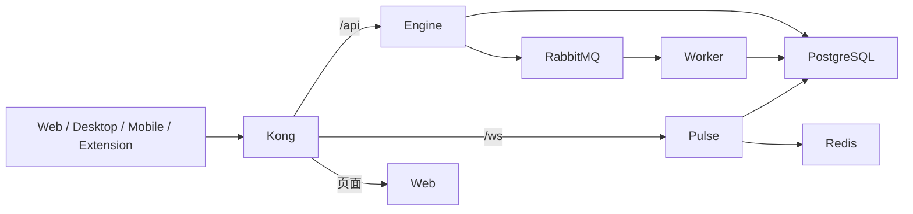

# Kong 网关与容器部署



Worker 是后台消费者，不通过 Kong 暴露业务端口。Kong 管理 API 默认关闭。服务和数据库位于 Compose 内网，外部只访问网关。

## 本地开发

`pnpm docker:dev` 启动 PostgreSQL、Redis、MongoDB、RabbitMQ 和 Kong。Kong 容器通过 `host.docker.internal` 访问本机 `dev:*` 服务。默认网关 http://localhost:8080，Engine 8000、Pulse 3001、Web 3000。

一次 `pnpm db:init` 完成 Prisma Client 生成与数据库初始化。运行三个后端服务及 Web 后即可通过网关访问，无需重放研发迁移、预先创建账号或准备发布状态文件。

## 服务器部署

使用 `docker/docker-compose.infra.yml` 与 `docker/docker-compose.app.yml` 组合。前者声明基础设施和 Kong，后者声明应用及一次性 Migrator。

基础设施与 Kong 同样固定 image digest；Testcontainers 直接读取部署 Compose 的版本，
开发 Compose 和 CI 临时数据库的一致性由合约测试检查。升级这些镜像时同步修改并重新验证，
避免同一应用版本在两个环境中使用不同的基础设施补丁版本。

Compose 中的 Kong 使用 `LAST,A,CNAME` 解析服务名，按配置端口连接 Docker 的 A 记录。
Docker 不提供这些服务名的 SRV 记录；优先查询 SRV 可能回退到公共 DNS，例如将 `web`
误认为公共 `.web` 域。镜像发布前会通过同一 Kong 配置验证页面与 HTTP/WS 授权边界。

默认开发分支为 `dev`，Nx affected 的默认基线也为 `dev`。PR 合入 dev 后自动
运行**全量** CI；`Required checks` 汇总格式、官方源安全扫描、类型、零警告 lint、覆盖率和
全部真实测试。分支与发布规则见 [分支维护](../development/branch-workflow.md)。通过后调用 `Deploy Ray`：构建五个镜像，在隔离基础设施中实际
运行迁移与服务，核对 image ID 后推送 registry，再按 digest 部署到 `staging`。
公开网关探针通过后，保存 `staging-release-<commit>` 部署记录，保留 30 天。

`main` 推送自动部署到 `production`。入口要求同一 SHA 已完成成功的 dev CI 与
staging 部署，校验来源仓库、工作流、运行次数和五个固定 digest，然后复用原镜像。
main 不再执行整套测试或重建镜像，但仍重新扫描依赖以拦截新披露的 high/critical
告警。PR、fork、不同 SHA、失败或进行中的 CI、过期记录、旧重跑记录均不能授权生产部署。
发布使用每个环境独立的串行队列；真正上传前再次核对分支，拒绝已经过时的排队任务。

### GitHub 配置

首次配置请按 [GitHub 部署配置清单](../development/github-deployment-setup.md) 操作，
其中包含逐项取值、主机指纹提取、服务器 `.env` 模板、首次创建 main 与故障恢复。

仓库变量（两套环境共用同一构建）：

| 变量                  | 用途                                                   |
| --------------------- | ------------------------------------------------------ |
| `BUILD_PUBLIC_ORIGIN` | 正式站点的 canonical URL，构建时用于 SSR/file 宿主回退 |
| `CONTACT_EMAIL`       | 公开联系邮箱，构建校验必填                             |

创建 `staging` 和 `production` 两个 GitHub Environments，各自只允许 `dev` 和
`main` 分支部署。以下配置分别存入两个 Environment，不放进仓库文件：

| 类型     | 名称                                           | 用途                                             |
| -------- | ---------------------------------------------- | ------------------------------------------------ |
| Secret   | `DEPLOY_HOST`、`DEPLOY_USER`、`DEPLOY_SSH_KEY` | SSH 主机、用户与私钥                             |
| Secret   | `GHCR_PULL_TOKEN`                              | 私有 GHCR 镜像只读拉取凭据                       |
| Variable | `PUBLIC_ORIGIN`                                | 该环境 HTTPS 网关 origin；不带路径或末尾斜杠     |
| Variable | `DEPLOY_HOST_FINGERPRINT`                      | 只填 `SHA256:哈希`，不含位数、用户或 `(ED25519)` |
| Variable | `DEPLOY_PATH`                                  | 服务器部署目录，默认 `/opt/ray`                  |
| Variable | `DEPLOY_PORT`                                  | SSH 端口，默认 22                                |

例如使用 `gh secret set DEPLOY_SSH_KEY --env staging --repo owner/repo < /安全路径/staging-key`
设置私钥；其他 secrets 可使用同一命令交互输入。用
`gh variable set PUBLIC_ORIGIN --env staging --repo owner/repo --body https://staging.example.com`
设置公开配置。不要把密钥发进聊天、PR 或 Actions 日志。服务器自身仍需预装 Docker
和 Compose，并创建该环境的 `.env`；仓库不会虚构服务器、域名或部署凭据。

部署主机在 `DEPLOY_PATH/.env` 配置数据库、Redis、RabbitMQ、认证密钥、`PUBLIC_ORIGIN`、`BETTER_AUTH_URL` 和业务需要的外部服务。公开 URL 应指向该环境的同一个网关域名。测试与正式环境必须使用独立的数据和配置；共用服务器时还要设置不同的 `COMPOSE_PROJECT_NAME`、部署目录及网关监听端口。

Web 的 API/认证默认走同源网关，邀请链接使用当前浏览器 origin，因此同一个镜像可在
两个域名下运行。SSR/file 宿主保留 `VITE_URL` 回退。其他公开 `VITE_*` 仍在构建时固定，
例如第三方前端 SDK key 与功能开关；本流程要求它们在这两套环境中兼容。需要不同值时，
先为对应能力设计明确的运行时配置，不能在 main 偷偷重建另一份未经 staging 验证的包。

`deploy.sh` 的顺序固定为：拉取镜像 → 等待基础设施 → 运行迁移 → 启动应用与 Kong 并等待健康状态。空数据库只执行一份初始化迁移；已初始化数据库只执行项目后来新增的迁移。

## HTTPS

默认 HTTP 支持本地验证。公开部署可以在外层负载均衡器终止 TLS，或设置 `KONG_AUTO_TLS=true` 启用自带 ACME 插件；后者需真实 `DOMAIN`、`ACME_EMAIL`、对外的 80/443 端口和正确 DNS。设置 `PUBLIC_ORIGIN=https://你的域名`，认证 URL 同步使用 HTTPS。

## 更新

先等待目标 dev 提交的整次 CI 成功，包括 `Deploy staging`。main 使用 fast-forward
推广同一提交；GitHub 的 merge/squash/rebase 按钮通常会产生新 SHA，不能复用原记录。
main 已存在时，在本地任意干净工作目录可执行（不会切换当前分支）：

```sh
git fetch origin dev main
git merge-base --is-ancestor origin/main origin/dev
git push git@github-ray-release:forkpath/postfly.io.git origin/dev:refs/heads/main
```

推送使用发布部署密钥（`github-ray-release` 是 SSH 配置中的别名），配置与完整检查见
[分支维护 · 发布](../development/branch-workflow.md#74-发布快进-main)。上面的祖先检查失败时先解决分支历史；
不要 force push。main 的 ruleset 要求同一 SHA 上的 `Required checks` 成功，并带有 `Staging verified` 状态
（只由 dev 推送后的 CI 在 staging 部署成功时写入），并只允许发布部署密钥更新，网页上的合并按钮无法修改 main。
dev 合并只要求 `Required checks` 与 `PR policy`，避免功能 PR 在合并前需要部署凭据。dev、arch、main 均禁止强推和删除；当前单维护者
设置不要求无法自行满足的额外人工 approval。CODEOWNERS 保留维护归属，团队增加成员后
可再要求独立代码审阅。

生产部署失败可在 main 手动重跑 `Deploy Ray`；所有提交/记录/安全门禁仍会执行。
staging 失败或记录过期时重跑该 dev CI 的部署 job；若是新的 workflow attempt，必须
生成对应次数的新记录；dev 必须仍指向目标 SHA，已前进时应使用新提交重新验证。成功记录不存在时没有“忽略检查直接发布”入口。

同一入口可重复发布。应用更新不清空数据库或持久卷；新版本有 schema 变化时先应用标准 Prisma migrations。应用镜像回退不会回退数据库，因此下游项目在上线后应审查兼容性并保留备份。这里没有框架专属的历史升级台账或切换开关。

移动设备继续使用既有 Gradle/CocoaPods/原生编译缓存，普通 dev 推送按 affected 选择；
完整矩阵保留在首次建分支、每周定时、手动和发布验证中。服务镜像另按服务复用 BuildKit
GitHub Actions 缓存。缓存不能替代实际设备流程、镜像 smoke 或部署后探针。

参考：[GitHub 可复用工作流](https://docs.github.com/en/actions/how-tos/sharing-automations/reuse-workflows)、
[跨运行获取 artifact](https://github.com/actions/download-artifact)、
[Docker 构建缓存](https://docs.docker.com/build/ci/github-actions/cache/)。
