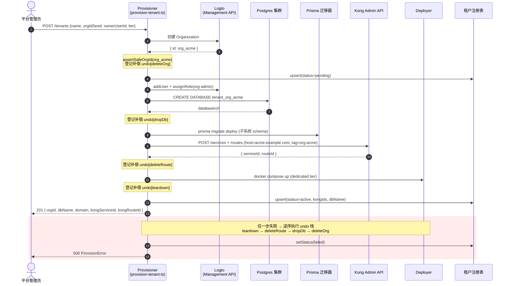
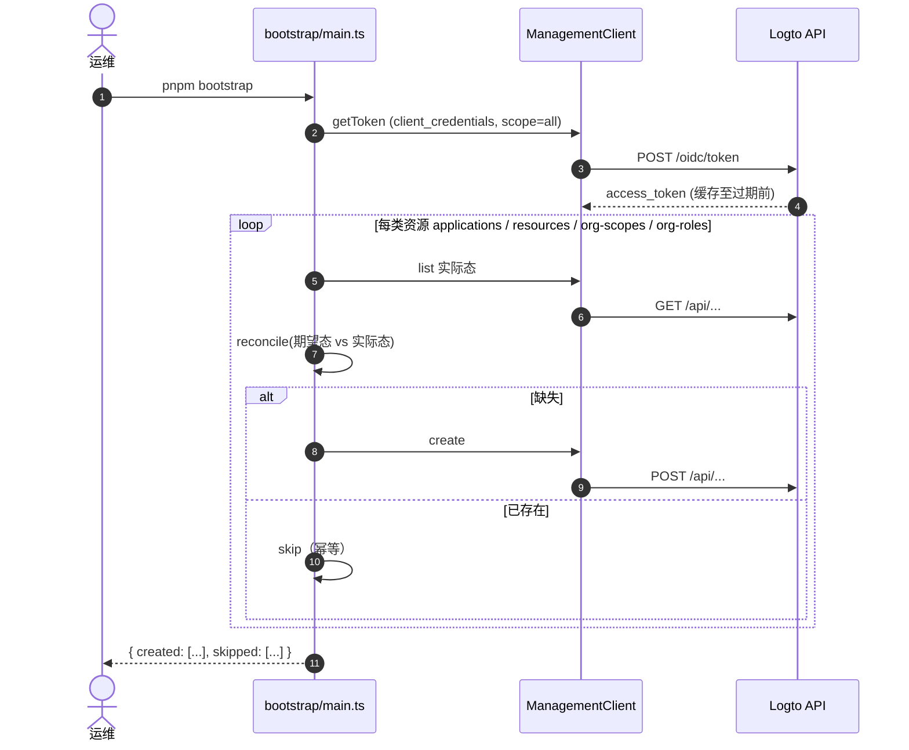
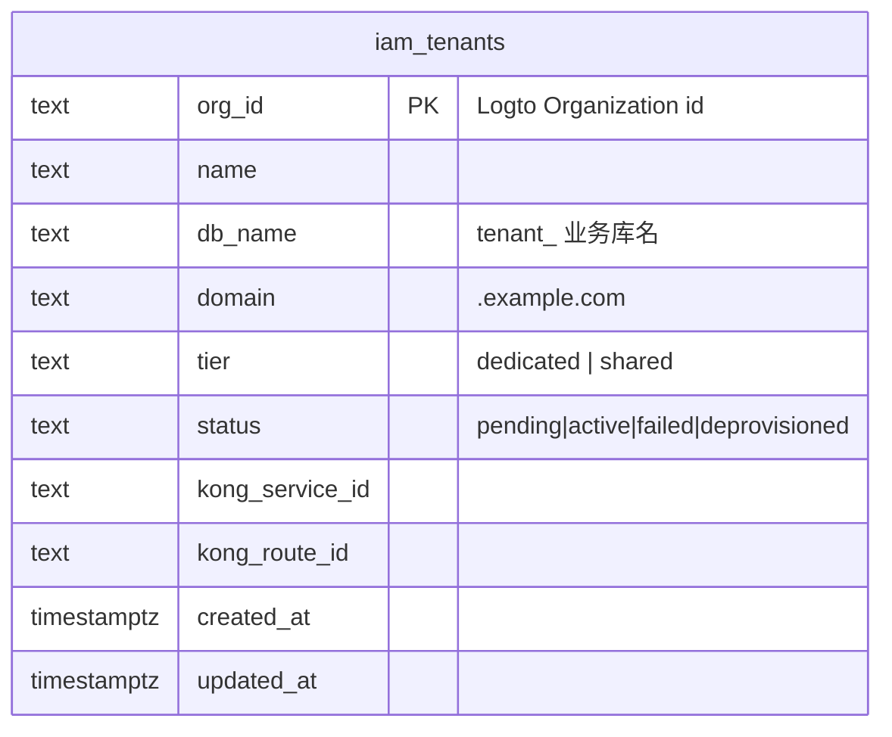
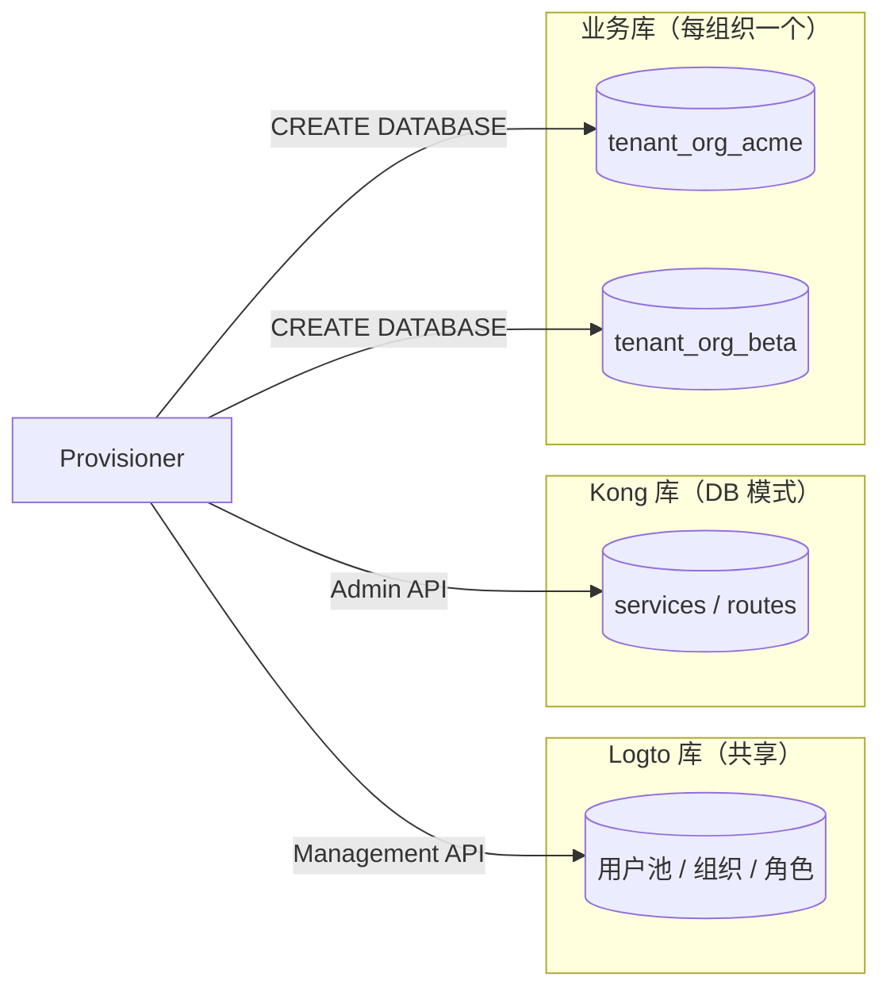
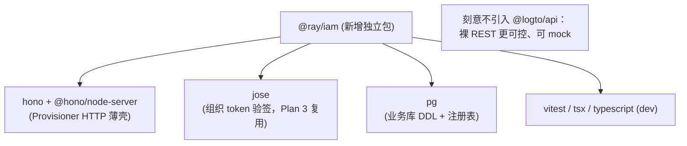

# Plan 1 — 独立 Logto IAM 平台：变更思路与数据流

> 配套实施计划：`docs/superpowers/plans/2026-06-30-logto-iam-platform.md`
> 已落地代码：`iam/`（独立 workspace，69 个单测全绿，`tsc --noEmit` 通过）

## 1. 这一阶段到底做了什么

把"身份/认证/组织/开通"从 ray 应用里**剥离成一个独立平台**，ray 应用代码**零改动**。交付三块：

| 模块 | 位置 | 职责 |
|---|---|---|
| Logto 部署 | `iam/deploy/docker-compose.yml` | 共享身份层（单实例、单用户池）+ Kong（DB 模式）+ 各自 Postgres |
| 配置即代码 | `iam/bootstrap/` | 用 Management API 幂等声明应用/API 资源/组织模板（角色+scope） |
| 开通控制面 | `iam/provisioner/` | 组织创建时编排：建 Logto 组织 → 建专属业务库 → 迁移 → Kong 路由 → 部署 → 登记，含逆向回滚 |

## 2. 核心设计决策与原因

### 2.1 为什么身份层"共享单实例"，而隔离放在业务层

**原因：跨组织用户（Slack 式）与 per-org 隔离天然冲突。** 单一用户池才能让同一个人属于多个组织、登录后切换。所以：

- **身份层（Logto）**：1 个实例、1 个用户池 → 用户可跨组织。OSS 单 tenant 限制对此无影响（组织数量无限）。
- **业务层**：每组织独立业务库 + 独立子系统实例 + 独立域名，由 Provisioner 在开通时编排。

身份层与业务层的唯一连接点是 **organization token（JWT）**：子系统从中取 `organization_id` + `scope` 决定"进哪个子系统、连哪个库"。

### 2.2 为什么不直接用 `@logto/api` SDK，而是裸 REST + 注入式 fetch

- 自托管下 SDK 的 endpoint 参数存在不确定性；裸 REST（`ManagementClient`）行为可控、**100% 可 mock 单测**。
- 所有副作用（Logto API、Postgres DDL、Kong Admin）都走**依赖注入**，因此整个编排层不需要真实基础设施即可完整测试（见 `provision-tenant.test.ts` 的回滚矩阵）。

### 2.3 安全要害：DDL 不可参数化 → 标识符白名单

`CREATE DATABASE "<name>"`、Kong tag `org:<id>`、子域、文件路径都来自 `orgId`，无法参数化。`iam/shared/src/identifier.ts` 是唯一防线：`assertSafeOrgId` / `tenantDbName` / `assertSafeDomainLabel` 用正则白名单拦截 `acme; DROP DATABASE`、`../etc` 等注入（`identifier.test.ts` 16 条用例覆盖）。

### 2.4 开通编排：补偿栈（Saga）而非分布式事务

跨 Logto / Postgres / Kong / 部署四个异构系统，没有 XA 事务。采用**补偿栈**：每完成一个有副作用的步骤就 push 一个 undo 闭包，任一步失败则**逆序**执行所有 undo，并把租户标记 `failed`。`provision-tenant.test.ts` 用"逐阶段失败"矩阵验证每条回滚路径，并显式断言补偿顺序为 `route → db → org`。

> Code-review 发现并修复：若 Logto 返回的 org id 未过安全校验就抛错，会在补偿栈登记前留下孤儿组织。已改为**先用原始 id 登记 undo，再校验**，并加回归测试锁定。

## 3. 数据流（泳道图）

### 3.1 开通一个组织（自动 provisioning）

### 3.2 配置即代码（幂等 Bootstrap）

## 4. 数据库变更

### 4.1 新增：租户注册表（控制面状态）

`iam/provisioner/src/pg-tenant-registry.ts` 自迁移建表：

### 4.2 每组织一个独立业务库

> 关键：身份共享、业务分库。注册表只存"指针"（org_id ↔ db_name/domain），不存业务数据。

## 5. 依赖变更

`iam/` 是**独立 workspace**（`pnpm install --ignore-workspace`），不挂 ray 的 nx 图、不污染根 `package.json`：

新增运行时基础设施（容器）：`logto`、`iam-postgres`、`kong`、`kong-database`、`kong-migrations`。ray 应用依赖**本阶段不变**（better-auth 仍在，Plan 3 才移除）。

## 6. 验证状态

- ✅ 单元/逻辑：69 测试全绿（identifier 16、jwt 5、authorize 9、reconcile/config/management-client、provision 回滚矩阵 9、kong-admin、manifest、deployer、registry、http）。
- ✅ 类型：`tsc --noEmit` 通过。
- ✅ Code-review：发现并修复孤儿组织缺陷 + 回归测试。
- ⏳ 需真实基础设施验证（标注于实施计划 A1–A8）：Logto 容器启动、Management API 实跑、真实 Postgres 建库迁移、Admin Console 核对。这些需 `docker compose up` + 手动管理员注册，属部署期冒烟，代码侧已就绪。
