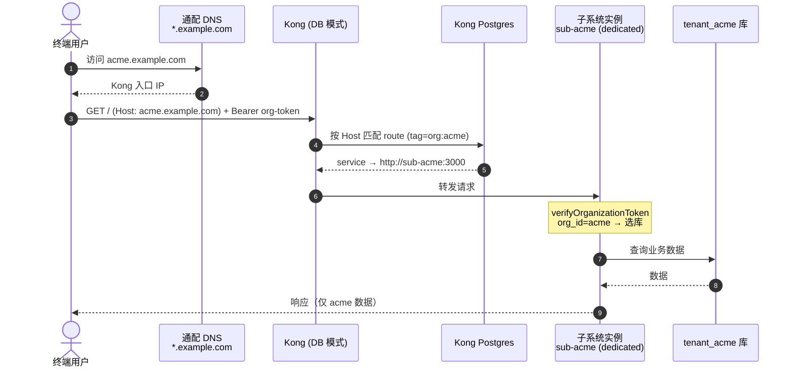
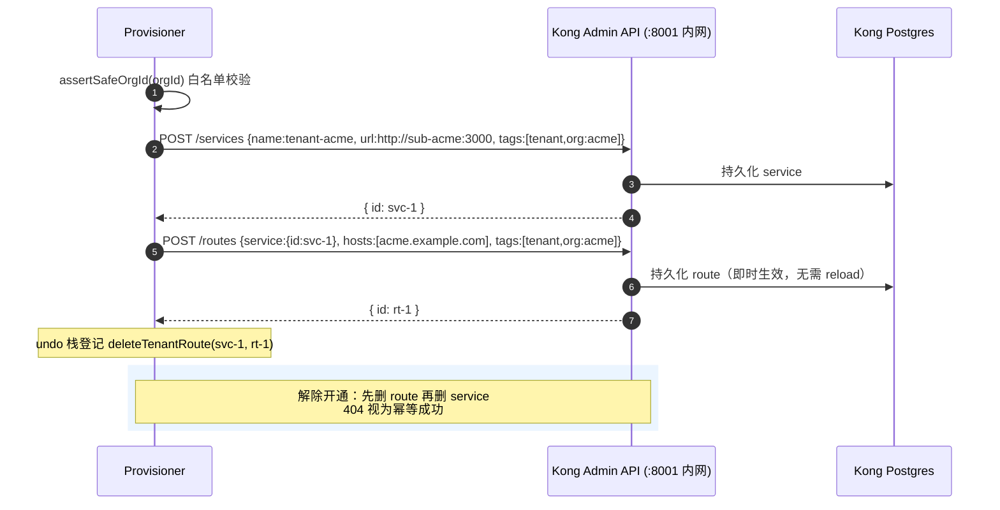
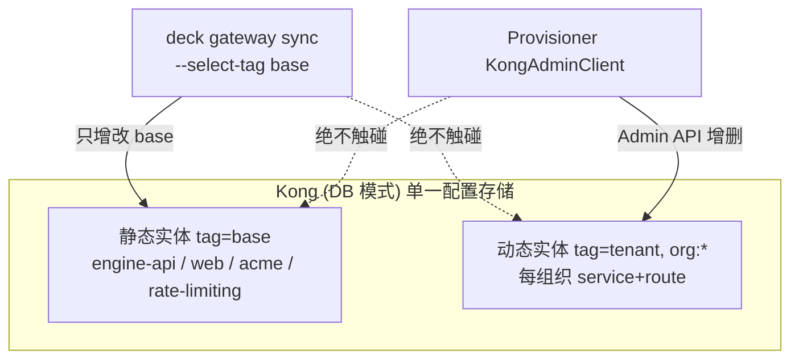
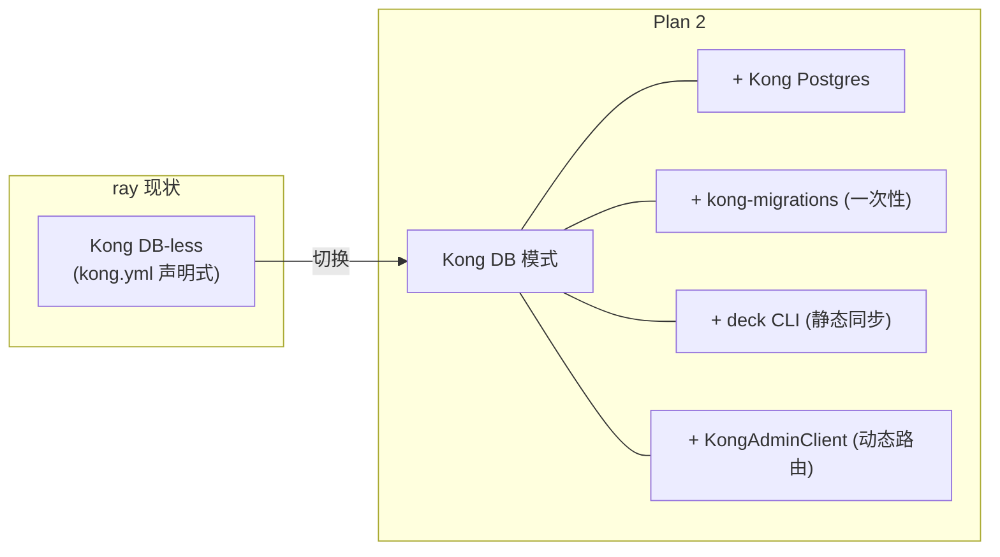

# Plan 2 — Kong 动态路由与域名自动化：变更思路与数据流

> 配套实施计划：`docs/superpowers/plans/2026-06-30-logto-routing-provisioning.md`
> 已落地代码：`iam/provisioner/src/routing/`、`iam/provisioner/src/deploy/`、`iam/deploy/kong/`

## 1. 这一阶段到底做了什么

把 Plan 1 的"逻辑开通"升级为"**物理可访问**"：每个组织拿到独立域名 `<org>.example.com`，请求经**现有 Kong 网关**按 Host 路由到该组织的子系统实例。

**关键决策：复用 ray 现有 Kong，不引入 Traefik。** ray 已用 Kong（`docker/kong/kong.yml`），再叠一层反代是重复建设。

## 2. 核心设计决策与原因

### 2.1 为什么把 Kong 从 DB-less 切到 DB 模式（方案 B）

| | DB-less（ray 现状） | DB 模式（本阶段） |
|---|---|---|
| 配置来源 | 声明式 `kong.yml` | Postgres |
| 动态加路由 | 改文件 + reload | Admin API 即时生效、持久化 |
| 多实例 | 各自持文件 | 共享同一份配置 |

每开通一个组织就要新增一条路由——DB 模式的 Admin API **写入即生效、可持久化、多 Kong 实例共享**，这是生产级做法。代价是 Kong 变有状态（多一个 Postgres），可接受。

### 2.2 静态配置 vs 动态路由：用 tag 隔离，防止 deck 误删

这是本阶段最容易踩坑的点：

- **静态基础设施配置**（engine/web/acme/限流，与组织无关）：从现有 `kong.yml` 转成 `iam/deploy/kong/base.yml`，全部打 `tags: [base]`，由 **deck** 幂等下发（`deck gateway sync --select-tag base`）。
- **动态租户路由**（每组织一条）：由 `KongAdminClient` 经 Admin API 创建，打 `tags: [tenant, org:<id>]`。

**`--select-tag base` 是要害**：deck 同步静态配置时只管 `base` 标签，**绝不会删除** Provisioner 动态建的 `tenant` 路由。两套配置在同一个 Kong 里互不干扰。

### 2.3 Admin API 必须内网隔离（ADR-0007）

`KONG_ADMIN_LISTEN` 仅绑内网 / `127.0.0.1`，**绝不映射公网**。Provisioner 与 Kong 同网络访问。`docker-compose.yml` 里 `8001` 只映射到 `127.0.0.1`，proxy 才暴露 `80/443`。

### 2.4 tier 决定实例形态，但路由方式统一

- `dedicated`：独立子系统容器 + 独立库，Kong Service 指向 `http://sub-<org>:3000`。
- `shared`：共享子系统容器，Kong Service 指向 `http://subsystem-shared:3000`，子系统从 token 的 `organization_id` 在应用内选库。

两者**对外都是独立域名**，差异只在 upstream 指向（见 `provision-tenant.ts` 的 `upstreamUrl` 分支）。

## 3. 数据流（泳道图）

### 3.1 运行时：终端用户请求如何被路由到正确的组织子系统

### 3.2 开通时：Provisioner 如何动态写入 Kong 路由

### 3.3 配置分层与 deck 隔离

## 4. 依赖与基础设施变更

新增代码模块（均有单测）：
- `routing/kong-admin.ts` — Admin API 客户端（fetch 注入，含安全校验、404 幂等删除）。`kong-admin.test.ts` 3 条。
- `deploy/manifest-renderer.ts` — dedicated/shared 部署清单渲染，机密用 env 占位不落盘。`manifest-renderer.test.ts` 3 条。
- `deploy/deployer.ts` — `Deployer` 接口 + `NoopDeployer`/`ComposeDeployer`（run 注入）。`deployer.test.ts` 4 条。
- `subsystem-migrator.ts` — 对租户库执行 `prisma migrate deploy`。

## 5. 数据库变更

- **Kong**：从无状态 → 有状态（新增 `iam-kong-pg` 库，存 services/routes/plugins）。
- **租户注册表扩展**：`iam_tenants` 增加 `kong_service_id` / `kong_route_id`（Plan 1 已含这些列），开通成功时回填，解除开通时据此回收。

## 6. 验证状态

- ✅ `KongAdminClient`：service/route 创建载荷、tag、安全校验、先删 route 再删 service 的 404 幂等——单测覆盖。
- ✅ 编排：`provision-tenant.test.ts` 的 deploy 失败用例断言 `deleteTenantRoute` 被调用回收。
- ⏳ 需真实基础设施（实施计划 A1–A9）：DB-mode Kong 起容器、`deck sync` 幂等 diff、`curl -H 'Host: acme.example.com'` 实际命中、Admin API 公网不可达验证。属部署期冒烟。
