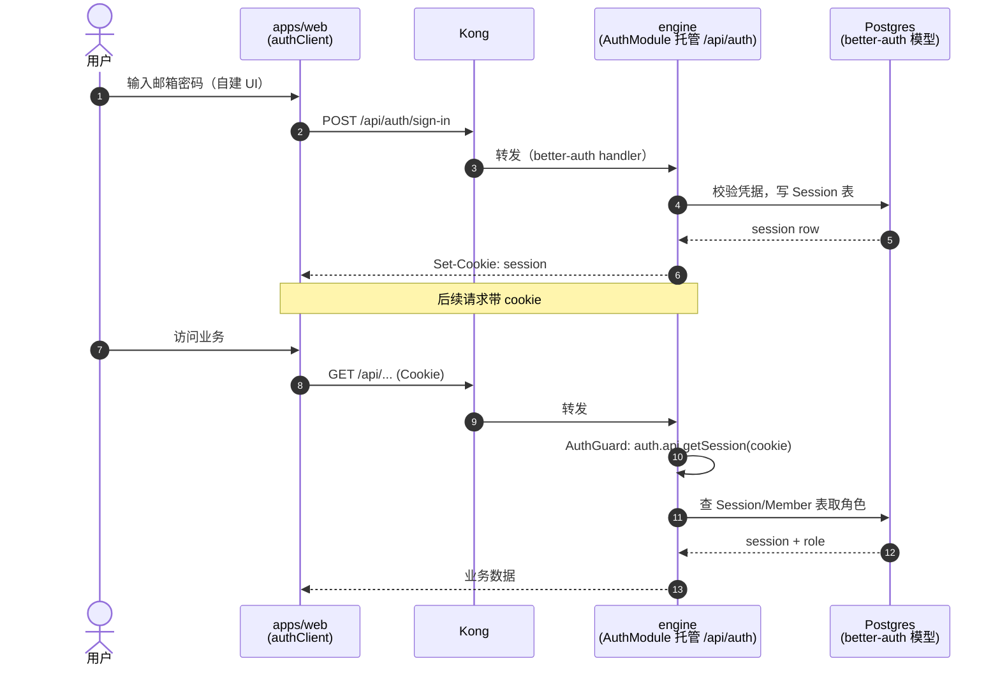
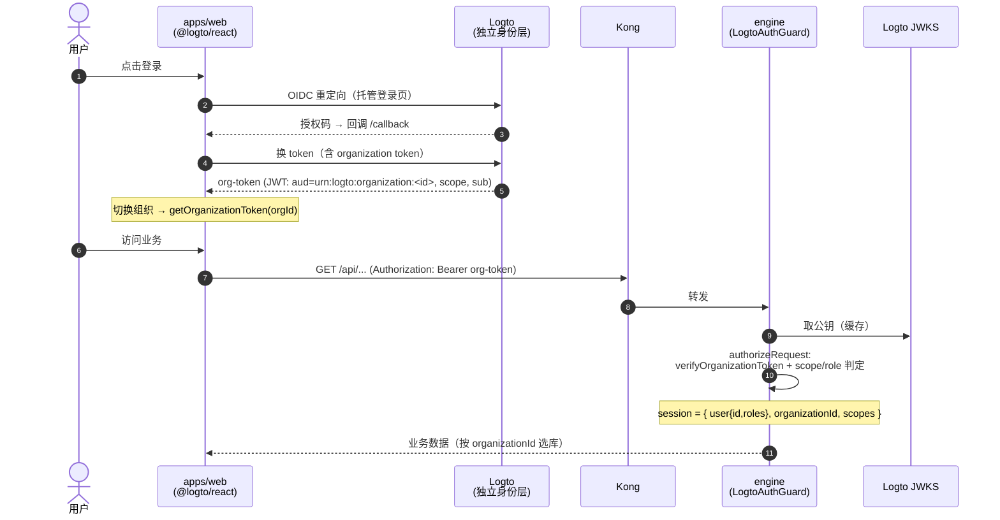
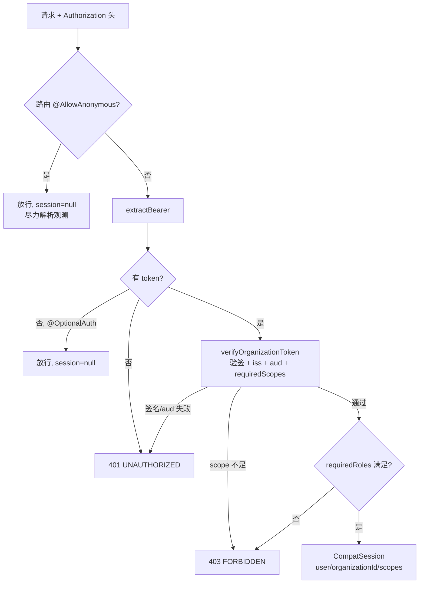
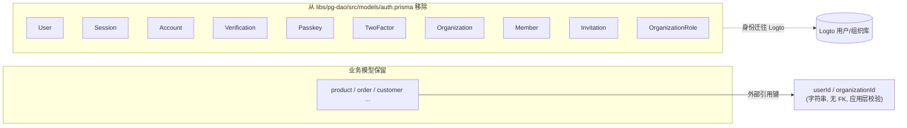
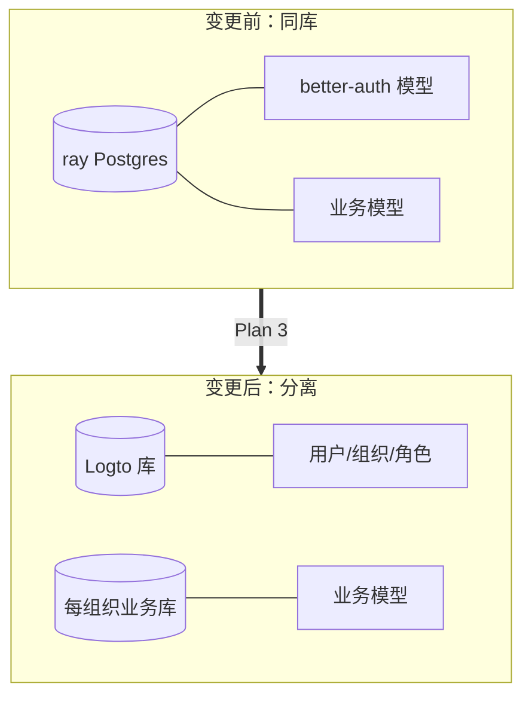
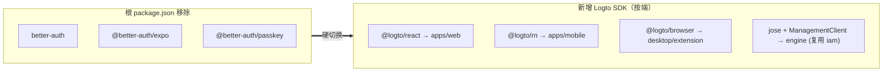

# Plan 3 — ray 硬切换 better-auth → Logto：变更思路与数据流

> 配套实施计划：`docs/superpowers/plans/2026-06-30-ray-logto-cutover.md`
> 认证内核已落地并测试：`iam/shared/src/authorize.ts` + `jwt.ts`（authorize 9 + jwt 5 单测全绿）
> ⚠️ **执行状态**：认证内核（最高风险、最值得先验证的部分）已在 `iam/` 实现并通过测试；对 ray 现有 143 个文件 / 4 个平台的**破坏性替换属部署期工程**，需在 Logto/Kong 实跑环境中逐平台推进，本文档澄清其思路、数据流与影响面。

## 1. 这一阶段到底做了什么

移除 ray 内置的 better-auth，改为**信任独立 Logto**：
- 引擎用 Logto 组织 token（JWT）做认证 + 粗粒度鉴权；
- 各端（web/mobile/desktop/extension）改用对应 Logto SDK 走 OIDC 登录；
- 细粒度业务权限留在子系统自身（不在本阶段）。

## 2. 核心设计决策与原因

### 2.1 ADR-0004：保持 NestJS 装饰器契约不变，改动面最小化

现有引擎大量用 `@Session()` / `@Roles([...])` / `@AllowAnonymous()` / `@OptionalAuth()`（定义在 `libs/srv-shared/src/auth/auth.decorator.ts`）。

**新 `LogtoAuthGuard` 复用同名装饰器与元数据键**，把 token claims 映射成与旧 `UserSession` **形状兼容**的 `request.session`（`{ user: { id, roles }, organizationId, scopes }`）。这样控制器方法体几乎零改动——改动集中在 guard 与 session 来源。

这正是 `iam/shared/src/authorize.ts` 的 `CompatSession` 与 `authorizeRequest` 所实现的：一个**框架无关**的鉴权判定核心，NestJS guard 只是它的薄包装。因为框架无关，它能在 `iam/` 里脱离 NestJS 完整单测（9 条用例覆盖 public/optional/缺 token/scope 不足/角色不符/坏签名）。

### 2.2 ADR-0005：用户/组织的"写"操作归 Logto Management API

引擎里直接调 `auth.api.*` 的写操作（ban/delete/revoke-session）是 IAM 职责。保留 HTTP 形状，内部改调 Management API（`iam` 已有 `ManagementClient` 与 `LogtoOrganizationProvisioner` 可复用）。

### 2.3 ADR-0006：hosted 登录取代自建 UI

`libs/studio/src/modules/auth/*`、各端自建登录/注册/2FA/passkey UI 删除，改为重定向到 Logto 托管登录页。组织管理 UI 改调 Management API 包装。

### 2.4 自底向上、垂直切片推进

引擎是所有客户端的信任锚，**先切引擎**，再 web → mobile → desktop/extension → 清库去依赖。每个 Phase 可 `nx run <project>:test` + 冒烟独立验证。

## 3. 数据流（泳道图）— 认证方式的根本改变

### 3.1 变更前：better-auth（session cookie，引擎托管认证）

**特征**：身份与业务**同库同进程**；认证态是 server-side session cookie；角色从 `Member` 表读；引擎既是业务后端又是身份提供者。

### 3.2 变更后：Logto OIDC（组织 token，引擎只验签）

**特征**：身份层**独立**；认证态是**无状态 JWT**；引擎只验签不查身份库；用户可跨组织（不同 org-token 对应不同 `organizationId` 与角色）；`/api/auth` 托管路由消失。

### 3.3 鉴权判定核心（authorizeRequest，已实现并测试）

## 4. 数据库变更

### 4.1 删除 better-auth 全部模型（greenfield，无数据迁移）

**要点**：身份数据完全迁出 ray 的 Postgres，落到 Logto 自己的库。业务表不再外键关联 `User`/`Organization`，改存 Logto 的字符串 id。`generate-auth-schema` 这个 nx target 一并删除。

### 4.2 身份与业务的库边界变化

## 5. 依赖变更

删除的代码目录：`libs/auth/**`、`libs/srv-shared/src/auth/**`、`libs/studio/src/modules/auth/**`、各端自建登录 UI。新增共享库 `libs/iam`（封装各端 SDK 配置 + NestJS LogtoAuthGuard，后者包装已验证的 `authorizeRequest`）。

## 6. 影响面与收口清单（执行时核对）

| 收口点 | 位置 | 动作 |
|---|---|---|
| 引擎装配 | `services/engine/src/app.module.ts:12,17,50` | `AuthModule`→`LogtoAuthModule`，移除 `/api/auth` 托管 |
| Kong 路由 | `iam/deploy/kong/base.yml` | 删 `engine-auth` Service/Route + `deck sync`（见 Plan 3 Task 4 Step 5）|
| 仓储去 auth.api | `services/engine/.../user.repository.ts` | 改调 Management API |
| api-client 双轨收敛 | `libs/api-client/src/domains/auth.ts` | 登录改走 Logto SDK，删 `/auth/login` 等 |
| scope 一致性 | `libs/iam/src/server/scopes.ts` ↔ `iam/bootstrap/src/config.ts` | 必须一致（护栏测试）|

## 7. 验证状态（如实标注）

- ✅ **认证内核**：`authorizeRequest` + `verifyOrganizationToken` 已实现，14 条单测覆盖核心鉴权路径（含坏签名、scope/角色不足、可选/匿名），`tsc` 通过。这是整个切换风险最高、最该先证明的部分，已证明。
- ⏳ **ray 破坏性替换**：引擎装配替换、4 端 SDK 接入、prisma 模型删除、better-auth 依赖移除——属部署期工程，需在 Logto/Kong 实跑环境逐平台执行并 `nx run <project>:test` + 全平台冒烟（实施计划 A1–A8）。本文档已澄清其思路、数据流、DB/依赖影响与收口清单，可据此安全推进。
- 风险控制：硬切换无并行，建议在功能分支完成全部 Phase 并通过 A1–A8 后再合并；合并前打 tag `pre-logto-cutover` 以便整体回退。
