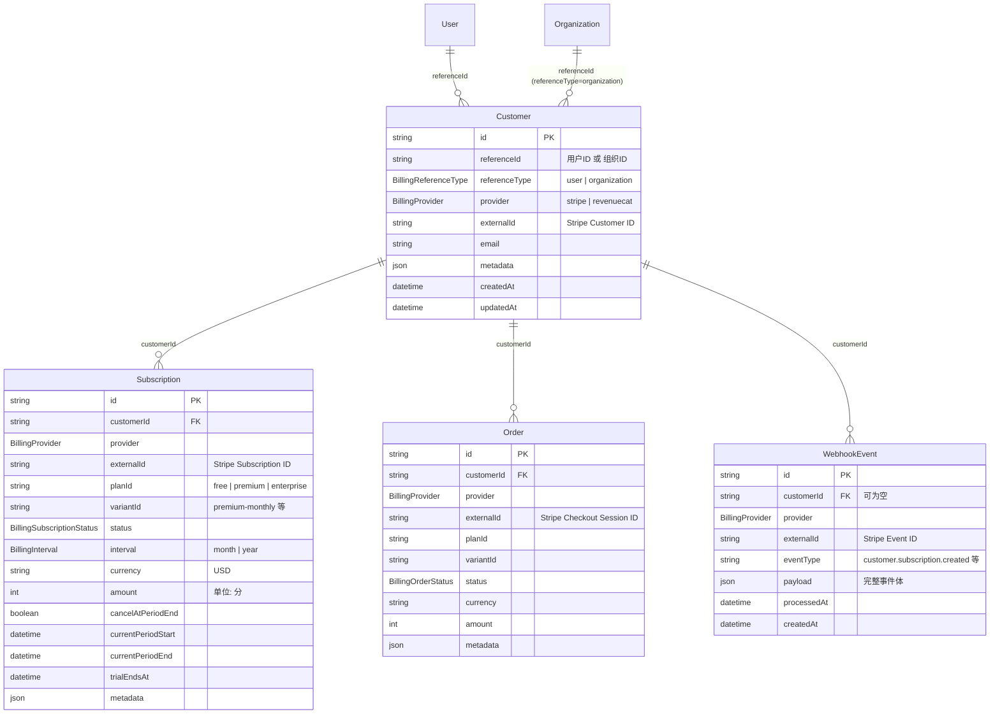
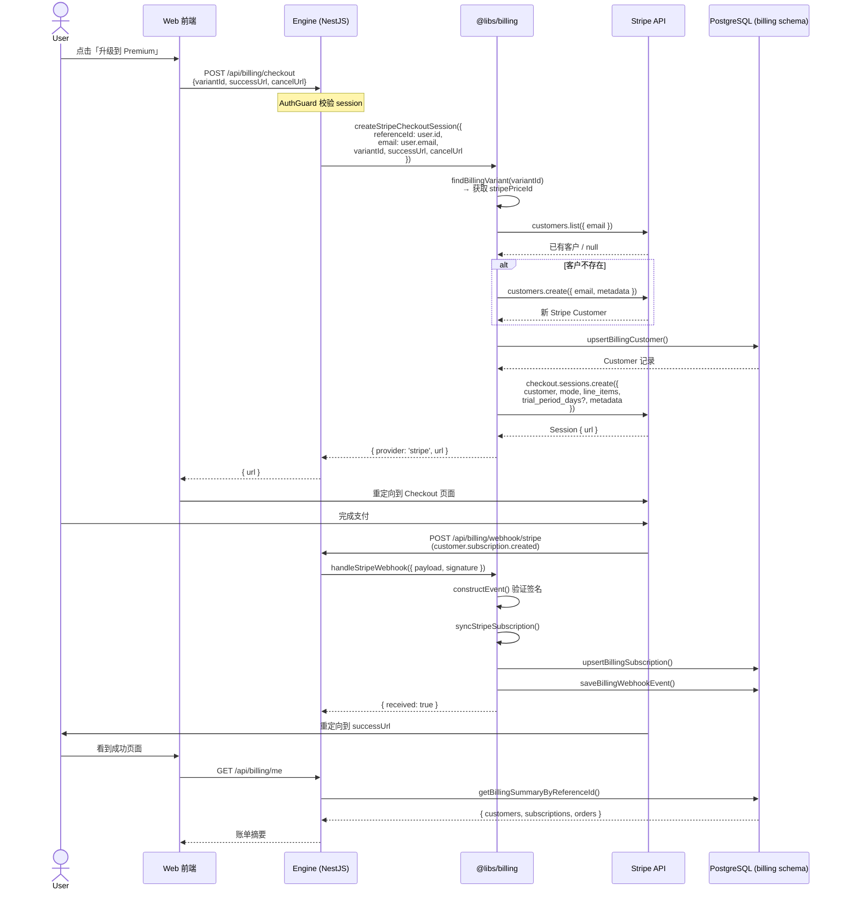
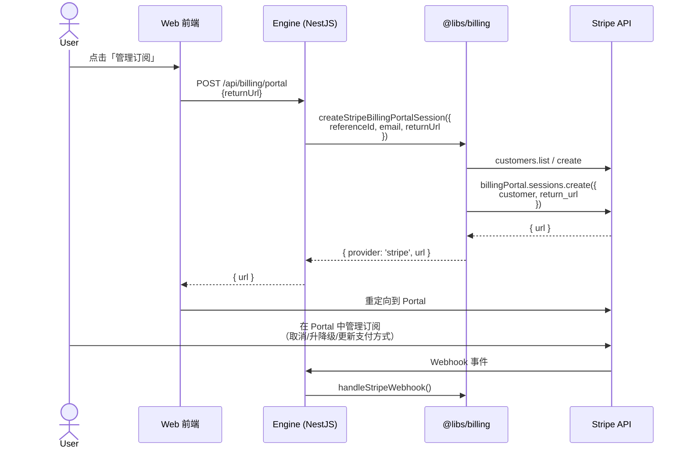
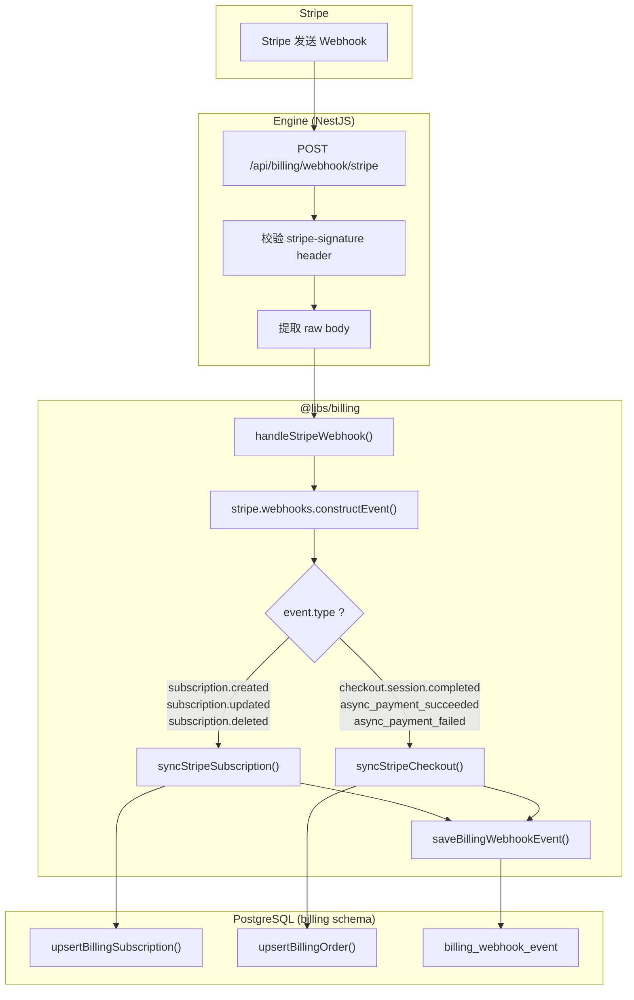
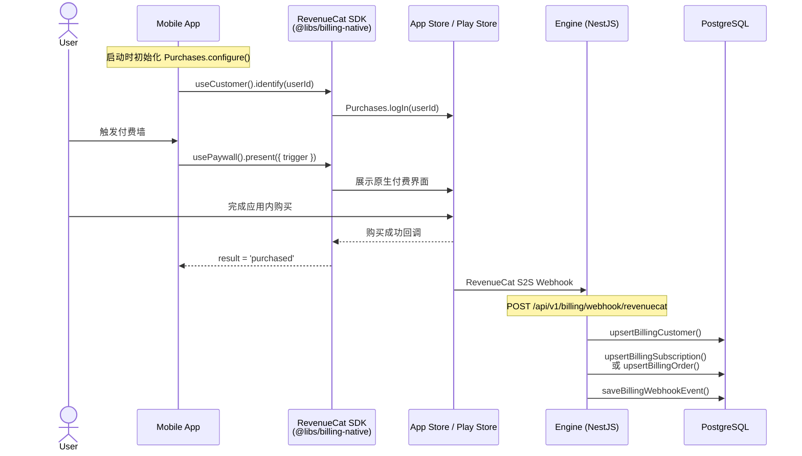
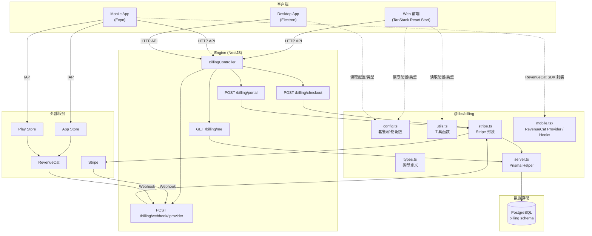

# Billing 模块集成指南

本文档面向 `ray` 仓库开发者，详细说明 Web 端、Mobile 端与 Engine（NestJS）后端在计费场景下如何协同工作。内容涵盖架构对比、数据模型、Stripe 集成流程、各端职责划分、业务数据流，以及当前实现中需要关注的改进项。

---

## 目录

- [一、架构概览](#一架构概览)
- [二、与 postfly 的对比分析](#二与-postfly-的对比分析)
- [三、数据模型](#三数据模型)
- [四、业务数据流](#四业务数据流)
- [五、Engine 端（NestJS 服务）](#五engine-端nestjs-服务)
- [六、Web 端（TanStack React Start）](#六web-端tanstack-react-start)
- [七、Mobile 端（Expo / React Native）](#七mobile-端expo--react-native)
- [八、三端协作全景](#八三端协作全景)
- [九、环境变量配置](#九环境变量配置)
- [十、改进项与注意事项](#十改进项与注意事项)

---

## 一、架构概览

Billing 正在按运行时拆分。通用值契约已经进入独立 Nx 项目，其余入口在
兼容期内仍由旧 facade 提供：

```
@libs/billing-contract → 公共类型、状态常量、传输记录
@libs/billing          → 兼容 facade、套餐配置、env preset、工具函数
@libs/billing/server   → Prisma 持久化 helper（customer/subscription/order/webhook CRUD）+ RevenueCat webhook
@libs/billing/web      → Stripe checkout/portal/webhook 实现
@libs/billing-native   → RevenueCat Provider、useCustomer、usePaywall
```

`ray` 的 provider 策略是**确定性的**：Web 固定 Stripe、Mobile 固定 RevenueCat，不做运行时多 provider 适配，保证调用链简单、类型收敛。

各端的依赖关系：

```
                    ┌─────────────────────┐
                    │   @libs/billing     │
                    │  types / config /   │
                    │  utils / env        │
                    └──────────┬──────────┘
                               │
              ┌────────────────┼────────────────┐
              ▼                ▼                 ▼
   @libs/billing/web   @libs/billing/server  @libs/billing-native
   (Stripe SDK)        (Prisma ORM)          (RevenueCat SDK)
              │                │                 │
              ▼                ▼                 ▼
   ┌──────────────┐  ┌──────────────┐  ┌──────────────┐
   │ Engine/Web   │  │ Engine       │  │ apps/mobile  │
   │ (调用 Stripe │  │ (数据库读写) │  │ (RevenueCat) │
   │  API)        │  │              │  │              │
   └──────────────┘  └──────────────┘  └──────────────┘
```

---

## 二、与 postfly 的对比分析

### 2.1 整体架构差异

| 维度 | postfly | ray |
|---|---|---|
| **分包粒度** | 3 个独立 npm 包（`shared` / `web` / `mobile`） | 1 个 Nx library，4 个子路径导出 |
| **ORM** | Drizzle（schema 与 billing 同库 `packages/db`） | Prisma multi-schema（独立 `billing` schema） |
| **API 框架** | Hono（路由文件 `router.ts`） | NestJS（Controller + Module） |
| **Provider 策略** | 完整策略模式（`BillingProviderStrategy` 接口 + 多 provider 实现） | 直接导出 Stripe 函数，无策略抽象层 |
| **Webhook 回调** | 支持 `WebhookCallbacks` 钩子注入 | 无回调机制 |
| **折扣码** | 支持 Stripe Promotion Code 查询与应用 | 配置中有 `discounts` 字段但当前为空数组，Stripe checkout 未实现折扣码传递 |
| **日志** | 全链路 `logger.info/error` | 无日志输出 |
| **错误处理** | 统一 `HttpException` + i18n 错误码 | 直接 `throw new Error()`，部分场景静默返回 |
| **Mobile 服务端** | RevenueCat/Superwall 完整的 webhook handler + API 客户端 | 固定 RevenueCat；`POST /api/v1/billing/webhook/revenuecat` + `handleRevenueCatWebhook` 同步订阅/一次性购买 |

### 2.2 Stripe 封装对比

| 功能点 | postfly | ray | 差异说明 |
|---|---|---|---|
| **Checkout Session 创建** | ✅ 完整 | ✅ 完整 | ray 额外在 metadata 中存储 `planId`/`variantId`；postfly 直接用 Stripe price ID 作 `variantId` |
| **Billing Portal** | ✅ | ✅ | 基本一致 |
| **Customer 创建/检索** | ✅ 先查 DB → 再查 Stripe（by ID 或 email）→ 创建 | ✅ 先查 Stripe（by email）→ 创建 → upsert DB | ray 省略了"先查 DB"步骤，每次都请求 Stripe API |
| **Subscription 同步** | ✅ 从 Stripe API 拉取完整对象 → upsert | ✅ 相同逻辑 | ray 额外存储 `interval`/`currency`/`amount`/`cancelAtPeriodEnd` |
| **Order 同步** | ✅ expand line_items 获取 variantId | ✅ 从 metadata 获取 variantId | ray 依赖 checkout metadata 而非 line_items |
| **Webhook 处理** | 4 种事件 + callbacks | 6 种事件 + webhook event 持久化 | ray 额外处理 `async_payment_succeeded/failed`，且记录所有 webhook 事件 |
| **折扣码/Promotion Code** | ✅ `getPromotionCode()` | ❌ 未实现 | 需要补充 |
| **Stripe API 版本兼容** | ✅ 兼容 Stripe 17/18+（period 字段位置差异） | ⚠️ 仅按 Stripe 18+ 格式取 items.data[0] | 建议增加兼容处理 |

### 2.3 数据模型对比

| 模型 | postfly（Drizzle） | ray（Prisma） | 差异 |
|---|---|---|---|
| **Customer** | `id, referenceId, externalId, provider, createdAt, updatedAt` | 同左 + `referenceType, email, metadata` | ray 更丰富，区分 user/org 类型，保存 email |
| **Subscription** | `id, customerId, externalId, variantId, status, store, periodStartsAt, periodEndsAt, trialStartsAt, trialEndsAt` | 同左 + `provider, planId, interval, currency, amount, cancelAtPeriodEnd, metadata` | ray 字段更多，保存完整的订阅财务信息 |
| **Order** | `id, customerId, externalId, variantId, status, store` | 同左 + `provider, planId, currency, amount, metadata` | ray 保存完整的订单金额信息 |
| **WebhookEvent** | ❌ 无 | ✅ `id, customerId, provider, externalId, eventType, payload, processedAt` | ray 独有，用于审计和重放 |
| **Schema 隔离** | 无（统一 public schema） | ✅ 独立 `billing` schema | ray 实现了数据域隔离 |

### 2.4 ray 的优势

1. **数据模型更完整**：`referenceType`（user/organization）支持组织级计费；`email`/`metadata`/`currency`/`amount` 等字段保留完整交易上下文
2. **Webhook 审计日志**：`WebhookEvent` 表记录所有收到的 webhook 事件，便于问题排查和事件重放
3. **Schema 隔离**：Prisma multi-schema 将 billing 数据隔离到独立 PostgreSQL schema，物理层面与业务数据分离
4. **更多 Webhook 事件覆盖**：处理了 `async_payment_succeeded/failed`（异步支付场景如 SEPA 银行转账）

---

## 三、数据模型

### 3.1 ER 关系图



### 3.2 幂等性设计

所有写操作采用 **upsert** 策略，冲突键为 `(externalId, provider)`：

- 同一个 Stripe Customer/Subscription/Order 无论 webhook 重复投递多少次，数据库中只会有一条记录
- `update` 分支覆盖所有可变字段，确保数据始终与支付平台同步

### 3.3 状态枚举

**订阅状态流转**：

```
                 ┌─────────────┐
                 │  incomplete  │ ← 首次支付未完成
                 └──────┬──────┘
                        │ 支付成功
                        ▼
               ┌────────────────┐
     ┌────────►│    trialing    │ ← 试用期（7天）
     │         └───────┬────────┘
     │                 │ 试用结束 + 首次扣款成功
     │                 ▼
     │         ┌────────────────┐
     │    ┌───►│     active     │◄──────────────┐
     │    │    └───┬────────┬───┘               │
     │    │        │        │                   │ 补缴成功
     │    │        │        │ 扣款失败          │
     │    │        │        ▼                   │
     │    │        │  ┌──────────┐              │
     │    │        │  │ past_due │──────────────┘
     │    │        │  └────┬─────┘
     │    │        │       │ 长期未付
     │    │        │       ▼
     │    │        │  ┌──────────┐
     │    │        │  │  unpaid  │
     │    │        │  └────┬─────┘
     │    │        │       │
     │    │        ▼       ▼
     │    │   ┌──────────────┐
     │    │   │   canceled   │
     │    │   └──────────────┘
     │    │
     │    │ 恢复订阅
     │    │
     │  ┌─┴───────┐
     │  │  paused  │ ← 暂停（由 Stripe 或业务触发）
     │  └─────────┘
     │
     │ 重新订阅
     └────────────────────────────────────
```

**订单状态流转**：

```
  ┌─────────┐   支付成功   ┌───────────┐
  │ pending │────────────►│ succeeded │
  └────┬────┘             └─────┬─────┘
       │                        │ 退款
       │ 支付失败               ▼
       ▼                  ┌──────────┐
  ┌─────────┐             │ refunded │
  │ failed  │             └──────────┘
  └─────────┘
```

---

## 四、业务数据流

### 4.1 Web 端 Stripe Checkout 全流程



### 4.2 Stripe Billing Portal 流程



### 4.3 Webhook 处理与数据同步



### 4.4 Mobile 端计费流程



---

## 五、Engine 端（NestJS 服务）

### 5.1 当前路由

Engine 的 `BillingController`（`services/engine/src/presentation/http/billing/`）提供 4 个端点：

| 方法 | 路径 | 认证 | 描述 |
|---|---|---|---|
| `GET` | `/api/billing/me` | ✅ Session | 获取当前用户的计费摘要（customers + subscriptions + orders） |
| `POST` | `/api/billing/checkout` | ✅ Session | 创建 Stripe Checkout Session，返回支付 URL |
| `POST` | `/api/billing/portal` | ✅ Session | 创建 Stripe Billing Portal Session，返回管理 URL |
| `POST` | `/api/billing/webhook/stripe` | ❌ 公开 | 接收 Stripe Webhook，通过签名验证安全性 |

### 5.2 Engine 端职责

Engine 是所有计费操作的唯一后端入口。任何支付相关的敏感操作（Stripe Secret Key 调用、Webhook 签名验证、数据库写入）都必须在 Engine 端完成。

**核心原则**：

1. **前端绝不接触 Secret Key** — Stripe Secret Key 仅存在于 Engine 环境变量中
2. **所有写操作经过 Engine** — 客户端（Web/Mobile）发起请求，Engine 执行实际的 Stripe API 调用和数据库操作
3. **Webhook 是数据同步的权威来源** — 不依赖客户端上报的支付状态，以 Stripe Webhook 推送为准

### 5.3 需要补充的端点

参考 postfly 的 API 设计，Engine 端应补充以下能力：

| 端点 | 用途 | 优先级 |
|---|---|---|
| `POST /api/billing/webhook/:provider` | 动态路由支持 mobile provider webhook | 高 |
| `GET /api/billing/plans` | 返回前端可展示的套餐配置列表（过滤 hidden 变体） | 中 |
| `GET /api/billing/subscription/active` | 查询当前用户是否有活跃订阅（简化前端判断） | 中 |
| Admin: `GET /api/admin/billing/customers` | 后台管理：分页查询客户列表 | 低 |

### 5.4 Webhook 端点注意事项

NestJS 默认启用 JSON body parser，但 Stripe Webhook 需要 **raw body** 来验证签名。当前 Controller 已正确处理了这一点（检查 `Buffer.isBuffer`），但需要确保 NestJS 配置中对 `/api/billing/webhook/*` 路径禁用自动 body 解析：

```ts
// main.ts 中需确认 rawBody 配置
const app = await NestFactory.create(AppModule, {
  rawBody: true
})
```

---

## 六、Web 端（TanStack React Start）

### 6.1 Web 端职责

Web 端仅负责：

1. **展示套餐选择 UI** — 从 `@libs/billing` 读取 `billingConfig` 渲染定价页面
2. **发起计费请求** — 调用 Engine API 获取 Checkout/Portal URL
3. **处理重定向** — 支付成功/取消后的页面路由
4. **展示账单状态** — 调用 `GET /api/billing/me` 获取并展示订阅信息

### 6.2 典型调用流程

```ts
// 1. 获取套餐列表用于 UI 展示
import { getBillingPlans, formatBillingPrice } from '@libs/billing'

const plans = getBillingPlans() // 自动过滤 hidden 变体

// 2. 发起 Checkout
const response = await fetch('/api/billing/checkout', {
  method: 'POST',
  body: JSON.stringify({
    variantId: 'premium-monthly',
    successUrl: `${window.location.origin}/billing/success`,
    cancelUrl: `${window.location.origin}/pricing`
  })
})
const { url } = await response.json()
window.location.href = url

// 3. 查询账单状态
const summary = await fetch('/api/billing/me').then(r => r.json())
const isActive = hasActiveSubscription(summary.subscriptions)
```

### 6.3 前端状态判断

```ts
import {
  hasActiveSubscription,
  getLatestSuccessfulOrder,
  findBillingPlan,
  BillingPlan
} from '@libs/billing'

// 判断用户当前套餐等级
function getUserPlanLevel(summary: BillingSummary): BillingPlan {
  // 优先检查活跃订阅
  const activeSubscription = summary.subscriptions.find(
    s => s.status === 'active' || s.status === 'trialing'
  )
  if (activeSubscription) return activeSubscription.planId as BillingPlan

  // 再检查成功的一次性订单
  const latestOrder = getLatestSuccessfulOrder(summary.orders)
  if (latestOrder) return latestOrder.planId as BillingPlan

  return BillingPlan.FREE
}
```

---

## 七、Mobile 端（Expo / React Native）

### 7.1 架构设计

Mobile 端直接绑定 **RevenueCat**。`@libs/billing-native` 内部封装 `react-native-purchases` + `react-native-purchases-ui`，对外仅暴露 `Provider` / `useCustomer` / `usePaywall` 三个符号。**没有运行时适配器、没有 provider 选择逻辑**。

```
apps/mobile
   │
   ▼
@libs/billing-native  →  react-native-purchases (SDK)
  Provider                react-native-purchases-ui (Paywall UI)
  useCustomer
  usePaywall
```

### 7.2 初始化

`Provider` 内部已处理 `Purchases.configure`，只需在 Root 层挂一次即可：

```tsx
import { Provider as BillingRevenueCatProvider, useCustomer } from '@libs/billing-native'

export const BillingProvider = ({ children }: { children: React.ReactNode }) => {
  const { locale } = useI18nConfig(state => state.config)

  return (
    <BillingRevenueCatProvider locale={locale}>
      {children}
      <Identity />
    </BillingRevenueCatProvider>
  )
}

const Identity = () => {
  const { identify, reset } = useCustomer()
  const session = authClient.useSession()
  useEffect(() => {
    if (session.isPending) return
    session.data?.user ? identify(session.data.user.id) : reset()
  }, [session, identify, reset])
  return null
}
```

环境变量：`EXPO_PUBLIC_REVENUECAT_IOS_API_KEY` / `EXPO_PUBLIC_REVENUECAT_ANDROID_API_KEY`（`mobileEnv` 中也兼容 `_APPLE_API_KEY` / `_GOOGLE_API_KEY` 命名）。

### 7.3 Paywall 与权益

```tsx
import { usePaywall, useCustomer } from '@libs/billing-native'

const Upgrade = () => {
  const { present, result } = usePaywall({
    onPurchase: () => console.log('purchased'),
    onDismiss: () => console.log('dismissed')
  })
  return <Button onPress={() => present({ trigger: 'premium' })}>升级</Button>
}

const Badge = () => {
  const { entitlements } = useCustomer()
  const active = entitlements.find(item => item.active)
  return <Text>{active ? active.id : 'free'}</Text>
}
```

### 7.4 Mobile Webhook 数据同步

Mobile 端的购买由 App Store / Play Store 处理，数据同步通过 **RevenueCat Server-to-Server Webhook** 完成。Engine 端 `POST /api/v1/billing/webhook/revenuecat` 已接入 `handleRevenueCatWebhook`，使用 `REVENUECAT_WEBHOOK_SECRET` 校验 `Authorization` 头，使用 `REVENUECAT_API_KEY` 拉取 subscriber 快照写回数据库。

---

## 八、三端协作全景



### 各端核心职责总结

| 层 | 职责 | 可访问的 billing 子路径 |
|---|---|---|
| **Web 前端** | UI 展示、发起请求、处理重定向 | `@libs/billing`（types/config/utils） |
| **Mobile 前端** | Paywall 展示、IAP 触发（直接使用 RevenueCat） | `@libs/billing`、`@libs/billing-native` |
| **Desktop 前端** | 同 Web（通过 Electron 加载 Web 内容） | `@libs/billing`（types/config/utils） |
| **Engine 后端** | Stripe API 调用、Webhook 处理、DB 读写 | 全部（`@libs/billing/*`） |

### 关键安全边界

```
┌─────────────────────────────────────────────────────┐
│                    客户端（公开）                      │
│  ✅ 读取套餐配置和类型                                 │
│  ✅ 使用 Stripe Publishable Key 展示 Elements         │
│  ✅ 格式化价格、判断订阅状态                           │
│  ❌ 不可直接调用 Stripe API                           │
│  ❌ 不可直接读写数据库                                 │
└─────────────────────┬───────────────────────────────┘
                      │ HTTP API（需认证）
┌─────────────────────▼───────────────────────────────┐
│                    Engine（私有）                      │
│  ✅ 持有 Stripe Secret Key                           │
│  ✅ 验证 Webhook 签名                                │
│  ✅ 执行数据库读写                                    │
│  ✅ 完整的错误处理和日志记录                           │
└─────────────────────────────────────────────────────┘
```

---

## 九、环境变量配置

### 9.1 Engine 端必需变量

```bash
# 计费对象类型（user=按用户计费, organization=按组织计费）
BILLING_REFERENCE_TYPE=user

# Stripe 密钥
STRIPE_SECRET_KEY=sk_live_xxx          # 或 sk_test_xxx（开发环境）
STRIPE_WEBHOOK_SECRET=whsec_xxx        # Stripe Dashboard → Webhooks 中获取
```

### 9.2 Web 端必需变量

```bash
# Stripe 前端公钥（用于 Stripe Elements / Checkout 重定向）
VITE_STRIPE_PUBLISHABLE_KEY=pk_live_xxx

# Stripe Price ID（在 Stripe Dashboard → Products 中创建后获取）
VITE_BILLING_STRIPE_PRICE_PREMIUM_LIFETIME=price_xxx
VITE_BILLING_STRIPE_PRICE_PREMIUM_MONTHLY=price_xxx
VITE_BILLING_STRIPE_PRICE_PREMIUM_YEARLY=price_xxx
```

### 9.3 Mobile 端必需变量

```bash
# RevenueCat（移动端唯一支付 provider）
EXPO_PUBLIC_REVENUECAT_IOS_API_KEY=appl_xxx
EXPO_PUBLIC_REVENUECAT_ANDROID_API_KEY=goog_xxx
EXPO_PUBLIC_REVENUECAT_PRODUCT_PREMIUM_LIFETIME=ray_premium_lifetime
EXPO_PUBLIC_REVENUECAT_PRODUCT_PREMIUM_MONTHLY=ray_premium_monthly
EXPO_PUBLIC_REVENUECAT_PRODUCT_PREMIUM_YEARLY=ray_premium_yearly
```

Engine 端补充的 RevenueCat 变量：

```bash
REVENUECAT_API_KEY=rcb_xxx              # Public API key，用于拉取 subscriber 快照
REVENUECAT_WEBHOOK_SECRET=whsec_rc_xxx  # Authorization 头校验共享密钥
```

### 9.4 Stripe Webhook 配置

在 Stripe Dashboard → Developers → Webhooks 中配置：

- **Endpoint URL**: `https://your-domain.com/api/billing/webhook/stripe`
- **Events to listen**:
  - `customer.subscription.created`
  - `customer.subscription.updated`
  - `customer.subscription.deleted`
  - `checkout.session.completed`
  - `checkout.session.async_payment_succeeded`
  - `checkout.session.async_payment_failed`

---

## 十、改进项与注意事项

### 10.1 高优先级

#### 1. 补充 Webhook 回调机制

当前 `handleStripeWebhook` 不支持业务回调。postfly 允许注入 `WebhookCallbacks` 以在事件发生时执行自定义逻辑（发送通知邮件、清除缓存、触发分析事件等）。

建议在 `handleStripeWebhook` 中增加可选的 `callbacks` 参数：

```ts
interface BillingWebhookCallbacks {
  onSubscriptionCreated?: (subscriptionId: string) => Promise<void>
  onSubscriptionUpdated?: (subscriptionId: string) => Promise<void>
  onSubscriptionDeleted?: (subscriptionId: string) => Promise<void>
  onCheckoutCompleted?: (sessionId: string) => Promise<void>
  onEvent?: (event: Stripe.Event) => Promise<void>
}
```

#### 2. 补充日志记录

当前 Stripe 操作缺少日志输出。在关键路径增加结构化日志：

- Checkout Session 创建成功/失败
- Customer 创建/检索结果
- Webhook 事件接收与处理
- 数据库 upsert 结果

#### 3. 增强错误处理

当前 `syncStripeSubscription` 和 `syncStripeCheckout` 在找不到 customer 或 variant 时静默返回。这会导致数据不一致且难以排查。建议：

- 记录警告日志而非静默返回
- 对可恢复的错误抛出明确异常
- 在 Controller 层统一捕获并返回结构化错误响应

#### 4. Customer 检索策略优化

当前每次创建 Checkout 都调用 `stripe.customers.list({ email })` 请求 Stripe API。postfly 的策略更高效：先查本地 DB，有 `externalId` 则直接用，避免不必要的 Stripe API 调用。

### 10.2 中优先级

#### 5. 实现折扣码支持

`billingConfig.discounts` 已预留但当前为空数组。参考 postfly 实现：

- 在 `BillingCheckoutInput` 中增加可选的 `discountCode` 字段
- 在 `createStripeCheckoutSession` 中调用 `stripe.promotionCodes.list({ code })` 查询
- 将有效的 promotion code 传入 checkout session 的 `discounts` 参数

#### 6. Mobile Provider Webhook 端点

- **RevenueCat**：已实现 `POST /api/v1/billing/webhook/revenuecat`（请求体为 raw JSON；`Authorization` 与 `REVENUECAT_WEBHOOK_SECRET` 一致；服务端可用 `REVENUECAT_API_KEY` 拉取 subscriber 同步账单数据）。

#### 7. Stripe API 版本兼容

当前 `syncStripeSubscription` 仅按 Stripe 18+ 格式从 `items.data[0]` 读取 period。建议增加向后兼容：

```ts
const periodStart = subscription.items.data[0]?.current_period_start
  ?? (subscription as any).current_period_start
```

### 10.3 低优先级

#### 8. getBillingPlans API 端点

增加一个公开的套餐查询端点，让前端可以从 Engine 获取最新的套餐配置，而非仅靠构建时打包的静态配置。

#### 9. 后台管理模块

参考 postfly 的 `admin/customers` 实现，为 Engine 增加管理端功能：

- 客户列表查询（分页、搜索、状态过滤）
- 订阅详情查看
- Webhook 事件查询和重放

#### 10. 清理占位文件

`src/lib/billing.ts` 仅包含占位函数，可以安全移除。

---

## 附录

### A. 套餐配置一览

| 套餐 | 变体 ID | 模型 | 价格 | 试用期 |
|---|---|---|---|---|
| Free | `free-lifetime` | 一次性 | $0 | — |
| Premium | `premium-lifetime` | 一次性 | $199 | — |
| Premium | `premium-monthly` | 循环（月） | $19/月 | 7 天 |
| Premium | `premium-yearly` | 循环（年） | $89/年 | 7 天 |
| Enterprise | `enterprise-contact` | 自定义 | 联系我们 | — |

### B. Prisma 模型名称映射

由于 Prisma `@@map` 指令，代码中的模型名称与数据库表名不同：

| Prisma 模型 | 数据库表名 | Schema |
|---|---|---|
| `Customer` | `billing.customer` | billing |
| `Subscription` | `billing.billing_subscription` | billing |
| `Order` | `billing.billing_order` | billing |
| `WebhookEvent` | `billing.billing_webhook_event` | billing |

> **注意**：Prisma Client 中的访问方式为 `prisma.billingCustomer`、`prisma.billingSubscription` 等（因为 Prisma 在 `billing` schema 下的模型名前缀会被保留）。当前 `server.ts` 使用的正是这些名称。

### C. Request 校验来源

`billing/checkout` 与 `billing/portal` 的 request 校验统一由 `@libs/payload` 提供，`@libs/billing/web` 只保留 Stripe checkout / portal / webhook 实现。
