# Ray 多子系统 SaaS 平台架构方案 —— IAM 统一身份 + dentalatlas 业务迁移重构

> 状态：**方案草案，待确认**。本方案基于对 `ray`（本仓库，已落地 `iam/` 身份平台）与 `dentalatlas`（现有牙科 CRM 业务仓库）两个代码库的实际代码走查产出，目标是把 dentalatlas 的业务**迁移重构进 ray**，而不是在 dentalatlas 原地调整架构。
>
> 配套已有文档：`docs/iam/plan1.md`（IAM 平台）、`docs/iam/plan2.md`（Kong 路由）、`docs/iam/plan3.md`（认证切换）、`iam/`（已落地代码，69 单测全绿）。本文档在此基础上，补齐"多子系统"维度，并给出 dentalatlas → ray 的具体迁移路径。

---

## 0. 前提假设（请逐条确认或纠正）

本文档在若干关键决策点上采用了"最合理默认值"，均已在下文标注 ⚠️。汇总如下，**这是全文档风险最高的部分，务必优先确认**：

| # | 假设 | 依据 | 影响面 |
|---|---|---|---|
| A1 | dentalatlas 当前是**单租户**：只有一家运营公司，doctor/supplier 是该组织下的外部受限成员，不是独立租户 | 代码实证：`Doctor.userId` 可空且指向同一 `User` 表；`SupplierProfile` 关联 `Member`（组织内成员） | 决定 Logto Organization 与"公司"是否 1:1 |
| A2 | doctor / supplier 继续采用"同组织受限角色 + CRM 自身细粒度权限"建模，**不**拆成独立组织 | 代码实证：`libs/auth/src/permissions.ts` 已有 `doctor`/`supplier` 角色，权限比 `member` 更窄，属于同一 access-control 体系 | 决定 IAM 只做粗粒度网关、细粒度权限完全留在 CRM |
| A3 | 本轮范围：**IAM 接入 + CRM 领域完整迁移**；IM/CDSS/TPS/CRS/IPS 五个子系统本轮只搭骨架（schema 占位、scope 占位、Nx 生成规范），不写业务逻辑 | 用户描述"逐渐引入" + 风险控制 | 决定第 11 章的详略程度 |
| A4 | dentalatlas 现有 `User/Session/Organization/Member/Invitation/OrganizationRole`（better-auth，`public` schema）里**没有必须零丢失保留的生产数据**，可以做一次性迁移脚本 + 硬切换，不强制要求灰度双跑 | 未确认，风险最高 | 决定第 10 章迁移脚本是"一次性批量导入"还是"双写灰度" |
| A5 | 每个子系统在代码结构上是**独立的 NestJS 服务**（`services/crm-engine`、`services/im-engine`…）+ 独立前端 app，只共享 `libs/pg-dao`、`libs/common`、`libs/api-client` 等库；ray 现有 `services/engine` 保留为"平台通用能力"（用户/组织/计费/存储/AI），不塞入具体业务子系统代码 | 用户描述"同一套框架做独立 app" + ray 现状（`services/engine` 目前只有 customer/organization/user/billing/storage/ai 这类平台级模块，没有业务域代码） | 决定第 9.3 章的服务拆分方案 |
| A6 | 子系统按"路径前缀"而非"独立二级域名"在同一个组织域名下路由（`acme.example.com/api/crm/*`、`acme.example.com/api/im/*`），只有**组织**这一级用二级域名区分 | 用户原话只提到"不同组织不同二级域名"，未提子系统是否也要分域名；路径前缀能复用现有 `KongAdminClient` 且证书管理更简单 | 决定第 7 章路由与 Kong 配置方案 |
| A7 | 物理多租户基础设施（每组织独立 DB + Kong 动态路由 + K8s 部署）**代码层面直接复用 ray 已落地的 `iam/provisioner`**，但当前只有一个真实组织，短期可以先用 `shared` tier 跑，不必立刻切 `dedicated` + K8s | 风险控制，`iam/` 的 `Deployer` 接口已支持两种 tier 平滑升级 | 决定第 8 章落地节奏 |

如果 A1/A2/A4 有误，请务必先纠正，因为它们会级联影响第 5、9、10 章的具体设计。

---

## 1. 背景与问题陈述

dentalatlas 从"牙科 CRM"起步，如今已经承担了远超 CRM 范畴的职责：

- 认证与组织管理（better-auth：`User/Session/Organization/Member/Invitation`）与业务逻辑（订单/物流/计费）**同库同进程**，边界靠 Prisma `@@schema` 人工维护，没有硬隔离。
- 细粒度业务角色（`doctor/sales/admin/qc/owner/supplier/finance_ops/clinic_manager`）直接借用 better-auth 的 Organization/access-control 插件表达，本质是把"IAM 该管的粗粒度身份"和"业务系统该管的细粒度权限"焊在了一起。
- 随着 IM（即时消息）、CDSS（智能诊断）、TPS（治疗方案）、CRS（理赔审查）、IPS（智能采购）等新职能被提出，如果继续往同一个 `dentalatlas` 仓库、同一个 `Organization/Member` 体系里叠加，会重复 CRM 今天的问题：**边界持续模糊、无法单独对外交付某一个子系统**。

## 2. 目标与非目标

**目标**

1. 引入 Logto 作为**独立、跨子系统共享**的 IAM：统一负责用户注册/登录/组织管理/粗粒度"能访问哪些子系统"的判定。
2. 把 dentalatlas 现有 CRM 业务**完整迁移**到 ray 仓库，成为 ray 平台下的第一个"业务子系统"，业务表收敛进 Postgres 的 `crm` schema。
3. 定义清晰、可复制的"新增子系统"规范，让 IM/CDSS/TPS/CRS/IPS 未来能以同样的模式接入，而不用每次重新发明身份/网关/部署方案。
4. 组织间（不同客户公司）物理隔离、组织内子系统间逻辑隔离（同库不同 schema）— 两级隔离模型在 ray 的 `iam/` 里已有基础设施雏形，本方案把它落到具体的子系统代码结构上。

**非目标（本轮不做）**

- 不在本轮实现 IM/CDSS/TPS/CRS/IPS 的具体业务逻辑（见假设 A3）。
- 不在本轮强制上线 K8s（见假设 A7），先在现有 docker-compose 基础上验证正确性。
- 不改变 CRM 现有业务规则（订单状态机、计费逻辑等）——这次是"搬家 + 换身份底座"，不是业务重构。

---

## 3. 总体架构总览

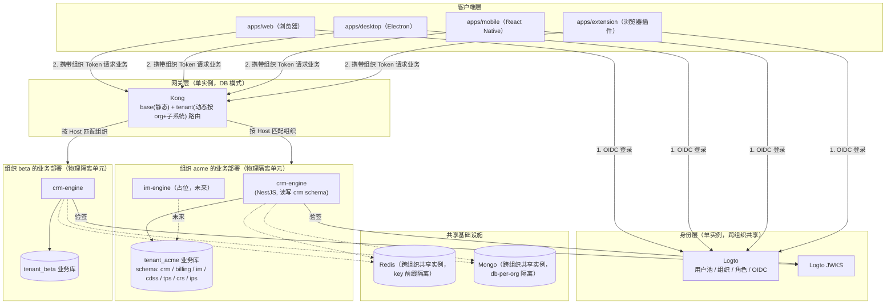

**分层职责**

| 层 | 组件 | 负责什么 | 不负责什么 |
|---|---|---|---|
| 身份层 | Logto | 用户是谁、属于哪些组织、粗粒度能访问哪些子系统（scope） | 具体订单能不能编辑这种业务权限 |
| 网关层 | Kong | 按组织域名 + 子系统路径把请求转发到正确的部署单元 | 鉴权判定本身（只转发，不验签） |
| 业务层 | 各子系统 engine | 验签 + 细粒度 RBAC + 业务逻辑 + 数据读写 | 用户注册/登录/组织成员管理这些身份类写操作 |

---

## 4. 核心概念与命名

| 概念 | 定义 | 落地位置 |
|---|---|---|
| Organization（组织/租户） | 一家采购 ray 平台服务的客户公司，对应 dentalatlas 现状里的"运营公司"本身 | Logto Organization |
| Subsystem（子系统） | CRM / IM / CDSS / TPS / CRS / IPS，产品意义上的独立业务模块 | 独立 NestJS 服务 + 独立 Postgres schema + 独立前端 app |
| Tier（部署档位） | `dedicated`（独立部署实例）/ `shared`（共享实例按 `organizationId` 选库） | `iam/provisioner`（已实现） |
| Scope（粗粒度访问权） | `access:crm` / `access:im` / …，决定某组织的某用户"进不进得去"某子系统 | Logto Organization Template scope（`iam/bootstrap` 已有 `access:crm`） |
| 子系统内角色（细粒度权限） | `doctor/sales/admin/qc/owner/supplier/finance_ops/clinic_manager`… | 子系统自己的数据表（CRM 场景即 dentalatlas 现有 `libs/auth/src/permissions.ts` 的 access-control 体系原样保留） |

---

## 5. 身份与权限模型

### 5.1 两级权限模型总览

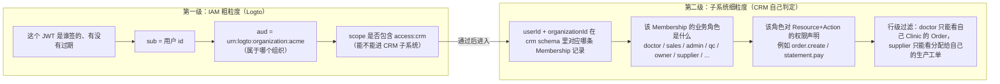

**关键原则**：Logto 完全不知道"doctor""qc""supplier"这些概念的存在，它只知道"这个用户能不能进 CRM"。业务角色、权限声明、行级过滤，**全部**留在 CRM 子系统自己的数据库和代码里 —— 这正是 dentalatlas 现状里 `libs/auth/src/permissions.ts` 已经做的事情，本次迁移**原样保留这套 access-control 逻辑**，只是把它的"我是谁"从 better-auth session 换成 Logto 组织 token。

### 5.2 IAM 层：Logto 资源设计（在 `iam/bootstrap` 现有基础上扩展）

`iam/bootstrap/src/config.ts` 目前已有：

```12:14:iam/bootstrap/src/config.ts
export const ORG_SCOPES = ['access:crm', 'access:billing', 'access:dashboard', 'manage:members'] as const
```

`access:crm` 已经预留好了 —— 说明这套 IAM 平台在设计时就是按"CRM 是第一个接入的子系统"来规划的。本方案在此基础上追加：

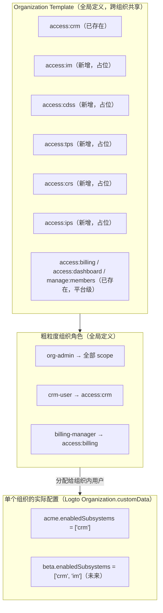

**为什么用 `Organization.customData` 而不是"组织级 scope 子集"**：Logto 的 Scope/Role 模板是**全局**的（所有组织共用同一套定义），组织与组织之间的差异（"acme 只买了 CRM，beta 买了 CRM+IM"）不是模板层面的概念，而是"这个组织实际启用了哪些子系统"这一运营信息，最贴切的落点是 Logto Organization 自带的 `customData`（任意 JSON）。Provisioner 在开通/追加子系统时读写这个字段，作为 Kong 路由生成、K8s 部署的依据（见第 7、8 章）。

### 5.3 CRM 子系统层：细粒度 RBAC 迁移方案

dentalatlas 现有的 `libs/auth/src/permissions.ts`（better-auth `createAccessControl`）定义了 9 个角色 × 13 类资源的权限矩阵（`owner/admin/member/sales/qc/supplier/doctor/finance_ops/clinic_manager`），这套逻辑**业务上完全正确、不需要重新设计**，问题只在于它目前"焊"在 better-auth 的 `Member.role` 字段上。迁移方案：

1. **保留** `ac`/`roles`/`statements` 这套定义，原样迁移到 ray 的 `services/crm-engine`（或抽成 `libs/crm-auth` 共享库，供 engine 与 `libs/studio/crm` 前端共用权限判定逻辑）。
2. **新增** `crm` schema 下的 `CrmMembership` 表，替代原来耦合在 better-auth `Member` 里的 `role` 字段：

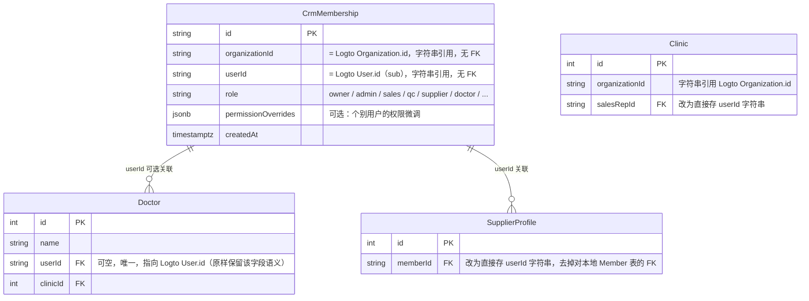

3. **鉴权判定改造点**：原来 NestJS 里 `@Roles(['admin', 'sales'])` 装饰器读取的是 better-auth session 里的 `Member.role`；改造后读取 `CompatSession.user.roles`（来自 `CrmMembership` 表的一次查询，而不是 JWT claim —— 细粒度角色**不进 JWT**，避免 token 膨胀和跨子系统语义泄漏，JWT 只携带粗粒度 `scopes`）。

> 这里刻意与 `docs/iam/plan3.md` 的 `CompatSession.user.roles` 字段做了区分：Plan 3 原设计是"从 token 的自定义 claim 取角色"，适用于粗粒度场景；CRM 场景角色更细、变更更频繁（业务人员随时调岗），改为**engine 侧查库**更合适。`CompatSession` 的形状不变，只是 `roles` 的来源从"token claim"变成"token 验签通过后按 userId+organizationId 查 `CrmMembership`"。

### 5.4 doctor / supplier 建模确认

沿用 dentalatlas 现状（见假设 A2），不引入新概念：

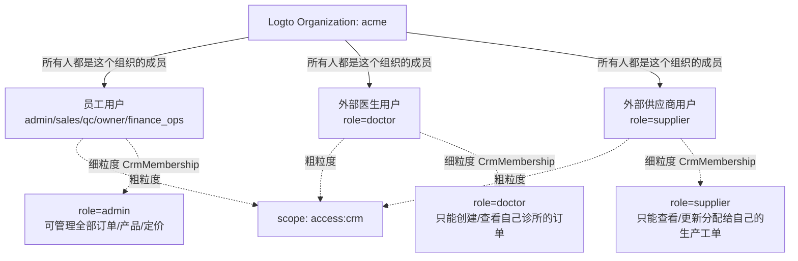

三类用户**同属一个 Logto Organization**，粗粒度 scope 一样（都能进 CRM），差异完全体现在 CRM 自己的 `CrmMembership.role` + 行级过滤上。这与 dentalatlas 现有实现完全一致，风险最低。

### 5.5 鉴权判定全链路时序图

以"医生提交一个新订单"为例，展示从登录到业务落库的完整链路：

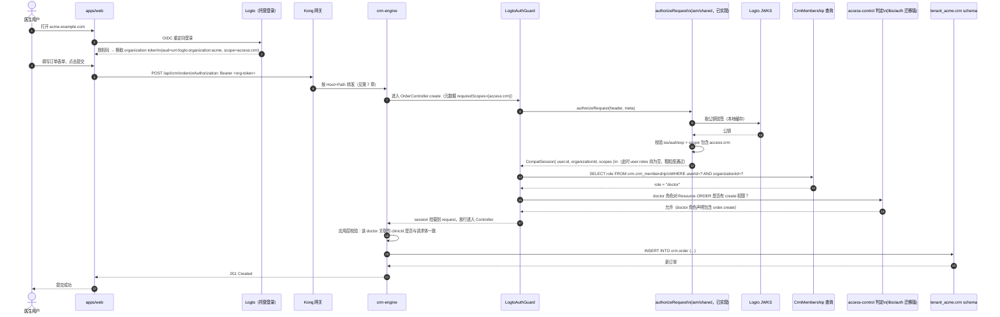

### 5.6 授权决策流程图

在 `docs/iam/plan3.md` 已有的 `authorizeRequest` 决策树基础上，追加"子系统细粒度判定"分支：

```mermaid
flowchart TD
    A["请求到达 crm-engine + Authorization 头"] --> B{"路由标注 @AllowAnonymous?"}
    B -->|是| Z["放行，session=null"]
    B -->|否| C["extractBearer"]
    C --> D{"有 token?"}
    D -->|否，@OptionalAuth| Z2["放行，session=null"]
    D -->|否| E["401 UNAUTHORIZED"]
    D -->|是| F["verifyOrganizationToken\n验签 + iss + aud + requiredScopes（粗粒度）"]
    F -->|签名/aud 失败| E
    F -->|scope 不含 access:crm| G["403 FORBIDDEN（连子系统大门都进不去）"]
    F -->|通过| H["查 crm.crm_membership\n(userId, organizationId) → role"]
    H --> I{"角色是否存在?"}
    I -->|否，用户不是该组织CRM成员| G
    I -->|是| J["access-control 判定：\nrole 对 Resource+Action 是否允许"]
    J -->|不允许| K["403 FORBIDDEN（细粒度权限不足）"]
    J -->|允许| L["应用层行级过滤\n(doctor 只查自己 clinicId 等)"]
    L --> M["CompatSession 挂载，执行业务逻辑"]
```

---

## 6. 多租户隔离与多子系统隔离模型

### 6.1 两级隔离总览

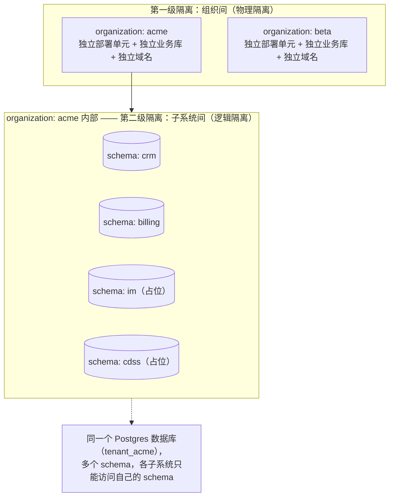

- **组织间**：完全独立的 `tenant_<org>` 数据库（沿用 `iam/provisioner/src/database-provisioner.ts` 的 `CREATE DATABASE` 方案，物理上是同一个 Postgres 集群里的不同逻辑库，未来也可以升级为不同物理实例）。
- **组织内**：同一个业务库里用 Postgres schema 区分子系统，权限上给每个子系统的数据库账号只授予自己 schema 的权限（`GRANT ALL ON SCHEMA crm TO crm_role;`），即使代码有 bug 误连错 schema，数据库层也会拒绝。

### 6.2 单组织业务库的 Schema 规划

```mermaid
erDiagram
    TENANT_DB {
        string name "tenant_acme"
    }
    SCHEMA_CRM {
        string name "crm"
        string owner "crm-engine 专属账号"
    }
    SCHEMA_BILLING {
        string name "billing"
        string owner "crm-engine 专属账号（计费目前归 CRM 域）"
    }
    SCHEMA_IM {
        string name "im"
        string owner "im-engine 专属账号（占位，未创建）"
    }
    SCHEMA_CDSS {
        string name "cdss"
        string owner "cdss-engine 专属账号（占位）"
    }
    SCHEMA_TPS {
        string name "tps"
        string owner "tps-engine 专属账号（占位）"
    }
    SCHEMA_CRS {
        string name "crs"
        string owner "crs-engine 专属账号（占位）"
    }
    SCHEMA_IPS {
        string name "ips"
        string owner "ips-engine 专属账号（占位）"
    }
    TENANT_DB ||--|| SCHEMA_CRM : contains
    TENANT_DB ||--|| SCHEMA_BILLING : contains
    TENANT_DB ||--o| SCHEMA_IM : "未来 contains"
    TENANT_DB ||--o| SCHEMA_CDSS : "未来 contains"
    TENANT_DB ||--o| SCHEMA_TPS : "未来 contains"
    TENANT_DB ||--o| SCHEMA_CRS : "未来 contains"
    TENANT_DB ||--o| SCHEMA_IPS : "未来 contains"
```

> `billing` 归入 CRM 域是延续 dentalatlas 现状（`libs/pg-dao/src/models/billing.prisma` 与 `crm.prisma` 强耦合，`Invoice/Statement/Payment` 都直接挂在 `Clinic` 下）。除非后续要把计费单独拆给多个子系统共用，本轮不拆分 `billing`。

### 6.3 与 dentalatlas 现状的隔离模型对比

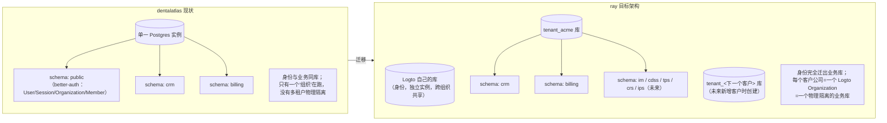

---

## 7. 网关与路由设计

### 7.1 域名与路径规则（假设 A6）

- 组织级隔离：`<org-slug>.example.com`（沿用 `docs/iam/plan2.md` 已实现的 `KongAdminClient.createTenantRoute`）。
- 子系统级区分：同一域名下按路径前缀，`/api/crm/*`、`/api/im/*`、`/api/cdss/*`……
- 前端页面路由同理：`acme.example.com/crm/...`、`acme.example.com/im/...`，由 `libs/studio` 里对应子系统模块各自注册路由（现状 `libs/studio/src/modules/crm` 已有 `nav-config.tsx` 骨架）。

### 7.2 Kong 配置分层扩展

现有 `KongAdminClient.createTenantRoute` 是"每组织一条路由，直接转发到 `sub-<org>:3000`"。为了让一个组织内的多个子系统都能被路由到，需要扩展为"每组织每子系统一条路由"：

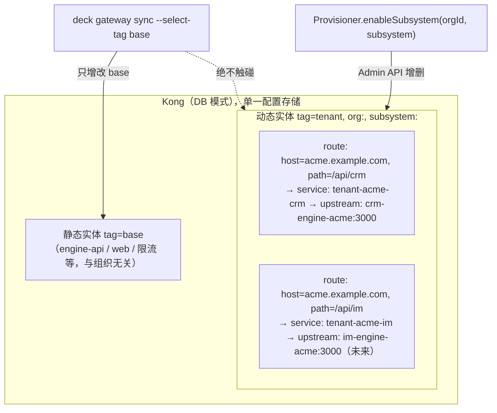

**代码改造点**（在 `iam/provisioner/src/routing/kong-admin.ts` 基础上）：

```ts
// 现状：createTenantRoute({ orgId, domain, upstreamUrl })，隐含"一个组织一条路由"
// 扩展：新增 subsystem 维度，tag 里加 `subsystem:<name>`，route 加 `paths: [\`/api/${subsystem}\`]`
async createSubsystemRoute(input: {
  orgId: string
  subsystem: string   // 'crm' | 'im' | 'cdss' | ...
  domain: string
  upstreamUrl: string
}): Promise<{ serviceId: string; routeId: string }>
```

这是对已实现代码的**最小扩展**（新增一个方法，不改动现有 `createTenantRoute` 的调用方），向后兼容。

### 7.3 请求路由时序图

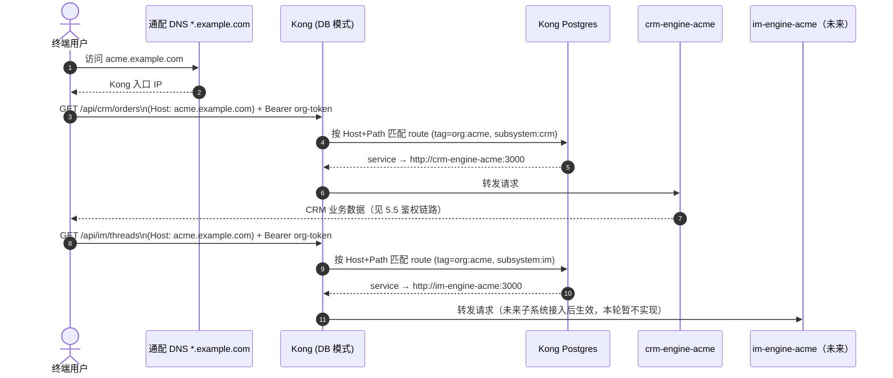

### 7.4 组织开通 / 追加子系统的编排时序图

在已实现的 `provisionTenant`（`iam/provisioner/src/provision-tenant.ts`）基础上，追加"开通后再启用一个新子系统"的独立编排（因为组织可能是先买 CRM，半年后才加购 IM）：

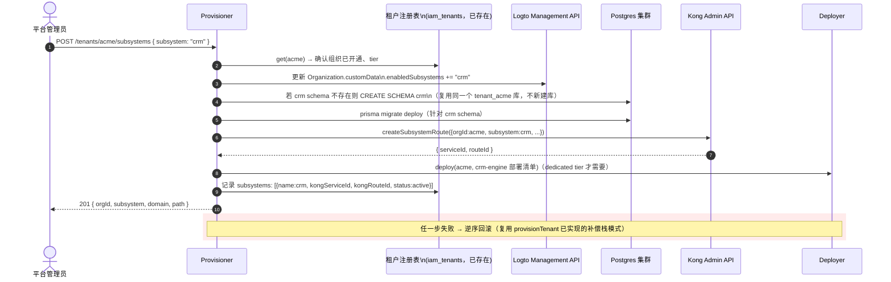

> 这个流程是对现有 `provisionTenant` 编排模式的**复用式扩展**，不是另起炉灶：补偿栈、幂等注册表、`assertSafeOrgId` 安全校验，全部沿用 `iam/provisioner` 已验证的模式。

---

## 8. 部署拓扑

### 8.1 当前已实现的部署方式

`iam/provisioner/src/deploy/deployer.ts` 目前只有两个实现：`NoopDeployer`（单测/shared tier 用）和 `ComposeDeployer`（`docker compose -p tenant-<org> up -d`）。**当前尚未实现 K8s 部署**，这是需要新增的工作，不是"已经有但没用上"。

### 8.2 目标 K8s 拓扑（后续扩展目标，非本轮必须）

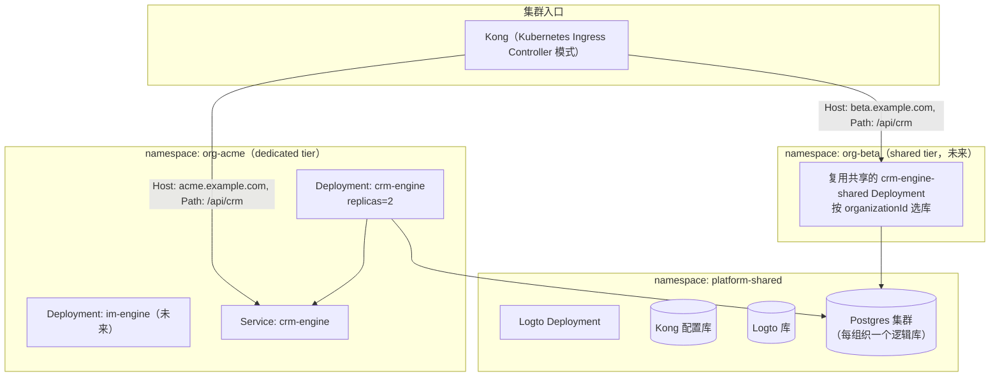

### 8.3 需要新增的扩展点

| 接口 | 现状 | 需要新增 |
|---|---|---|
| `Deployer`（`iam/provisioner/src/types.ts`） | `NoopDeployer` / `ComposeDeployer` | `K8sDeployer implements Deployer`：`deploy()` 用 `kubectl apply` 或 K8s client-node 创建 Namespace + Deployment + Service；`teardown()` 删除对应 Namespace 或资源 |
| `manifest-renderer.ts` | 渲染 docker-compose service 片段 | 新增 `renderK8sManifest()`：渲染 Namespace/Deployment/Service YAML，机密仍用 Secret 引用而非明文 |
| Kong | Admin API 直连 | 生产建议切到 Kong Ingress Controller + CRD（`KongIngress`/`TCPIngress`），Provisioner 改为创建 K8s CRD 而非直接调 Admin API（可平滑过渡：先保留 Admin API 调用，K8s 化是后续独立任务） |

---

## 9. 代码与仓库迁移方案（dentalatlas → ray）

### 9.1 为什么是"迁移进 ray"而不是"原地改造 dentalatlas"

1. ray 已经把 IAM 平台的高风险部分（鉴权内核、Provisioner 编排、Kong 动态路由）做完并测试通过，dentalatlas 从零实现一遍是重复劳动。
2. ray 的 `services/engine`、`libs/studio`、`libs/payload`、`libs/api-client` 已经预留了"平台通用能力 + 子系统模块"的目录结构（例如 `libs/studio/src/modules/crm` 已有布局骨架），是专门为承接多子系统设计的新地基。
3. dentalatlas 仓库整体退役为"历史归档"，避免两边代码长期并存、双份维护成本。

### 9.2 模块映射表

| dentalatlas 路径 | 迁移到 ray 的路径 | 处理方式 |
|---|---|---|
| `libs/pg-dao/src/models/crm.prisma`（35 个 model） | `libs/pg-dao/src/models/crm.prisma` | 整体迁移，`@@schema("crm")` 不变；断开对 `Member`/`User`（better-auth）的 FK，改为存字符串 `userId`/`organizationId` |
| `libs/pg-dao/src/models/billing.prisma`（22 个 model） | `libs/pg-dao/src/models/billing.prisma` | 整体迁移；ray 已有同名文件（当前是占位/通用计费），需要人工 diff 合并，以 dentalatlas 的业务字段为准 |
| `libs/pg-dao/src/models/auth.prisma`（User/Session/Organization/Member/Invitation/OrganizationRole/Account/Verification/Passkey/TwoFactor） | **不迁移**，废弃 | 身份彻底交给 Logto；`Member.role`/`OrganizationRole` 的语义迁移为新建的 `crm.CrmMembership`（见 5.3） |
| `services/engine/src/{domain,application,infrastructure,presentation}` 里 order/clinic/lab/billing/price-policy/product-catalog/shipping/supplier-profile/tag/workspace 相关代码 | 新建 `services/crm-engine/src/{domain,application,infrastructure,presentation}`（DDD 分层结构原样保留） | 按 Clean Architecture 分层整体搬迁，`@Session()`/`@Roles()` 装饰器改造为读 5.3 节的 `CrmMembership` |
| `services/engine/src/presentation/http/auth`、`organization-profile`、`invitation` | **不迁移** | 由 Logto 托管登录页 + Management API 取代（同 `docs/iam/plan3.md` 的 ADR-0006） |
| `libs/studio/src/modules/crm` | `libs/studio/src/modules/crm`（ray 已有同名骨架） | dentalatlas 目前没有这个目录名，需要从 `apps/web` 现有的 CRM 相关路由/组件反向拆分出来，填充进 ray 已搭好的骨架 |
| `libs/payload/src/schemas/{order,clinic,lab,price-policy,product-catalog,shipping,supplier-profile,tag,workspace,...}.schema.ts` | `libs/payload/src/crm/*.schema.ts` | 整体迁移，路径调整以匹配 ray 现有 `libs/payload/src/{admin,auth,billing,organization,shared,storage}` 的分类习惯，新增 `crm` 分类 |
| `libs/api-client/src/domains/crm/*` | `libs/api-client/src/domains/crm/*`（ray 目前只有 `admin/auth.ts/billing.ts/organizations.ts/storage.ts/users.ts`，无 crm） | 整体迁移，新增 `crm.ts` 或 `crm/` 目录，登录相关调用改为 Logto SDK |
| `libs/auth/src/permissions.ts`、`role-permissions.ts` | 新建 `libs/crm-auth`（或 `libs/studio/crm` 内部） | 保留 access-control 判定逻辑，去掉对 better-auth 类型的依赖 |

### 9.3 服务拆分方案

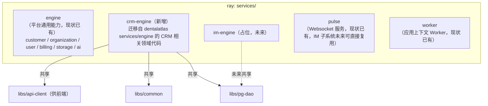

**为什么 CRM 不并入现有 `services/engine`**：ray 现有 `engine` 的四个域（customer/organization/user/billing/storage/ai）是"任何子系统都要用的平台能力"，语义上属于平台层；而 CRM 是具体的业务子系统，二者生命周期、扩缩容需求、发布节奏都不同（CRM 订单高峰要单独扩容，不应该拖累平台通用服务）。拆成独立服务也让"这个子系统能不能单独对外交付"这个目标从代码结构上就成立。

> ⚠️ 这是本方案的一个关键架构判断，对应第 0 章假设 A5，请重点确认。

### 9.4 数据库迁移步骤

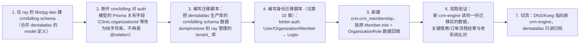

---

## 10. 认证迁移（better-auth → Logto）

### 10.1 迁移前后对比（改编自 `docs/iam/plan3.md`，落到本次具体场景）

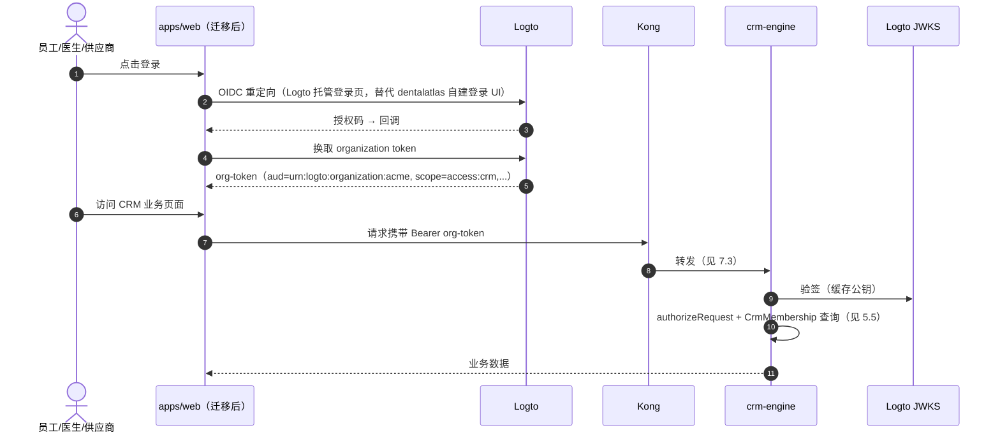

**与 dentalatlas 现状的核心差异**：`/api/auth/*` 这一组 better-auth 托管路由完全消失；`services/crm-engine` 里不再有 `presentation/http/auth`、`invitation` 模块；组织成员邀请改为调用 Logto Management API（`iam/bootstrap/src/management-client.ts` 已有裸 REST 客户端可复用）。

### 10.2 用户 / 组织数据迁移脚本设计

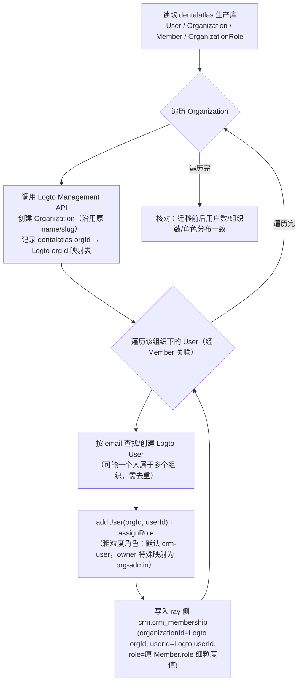

- 脚本以 `iam/bootstrap` 已有的 `ManagementClient`（裸 REST + 注入式 fetch，可 mock 单测）为基础扩展，保持"所有副作用可注入、可单测"的既有工程风格。
- 关键幂等设计：全程按"先查是否已存在，不存在才创建"执行，脚本可安全重跑（对应假设 A4，如果后续发现有生产数据要保留，这个脚本可以直接用于正式迁移，无需重写）。

### 10.3 密码 / 会话处理

better-auth 的密码哈希、Session、Passkey、TwoFactor 均**不迁移**——用户首次在 Logto 登录页走"忘记密码/首次设置密码"流程重置。这是硬切换（假设 A4）下最简单的方案；如果实际上不能接受用户重新设置密码（比如活跃用户很多，重设密码体验差），需要单独评估 Logto 是否支持"预先导入密码哈希"（取决于哈希算法兼容性，需要另外调研，本文档不展开）。

---

## 11. 未来子系统扩展规范

### 11.1 新增子系统 Checklist

以后接入 IM/CDSS/TPS/CRS/IPS 中任意一个，都遵循同一份清单（本轮只需要在文档层面定义，不需要真的执行）：

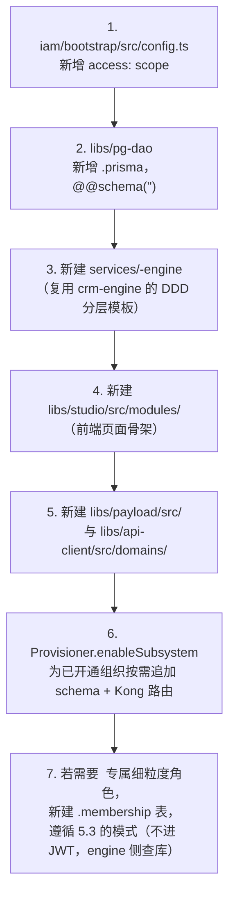

### 11.2 IM 子系统的特别说明

IM（医技即时消息）大概率需要 WebSocket 长连接，ray 已有 `services/pulse` 服务专门做这件事，未来 IM 子系统的实时消息推送应直接复用 `pulse`，而不是在 `im-engine` 里重新实现一套 WebSocket 网关——`pulse` 按 `organizationId` 做房间/频道隔离即可。

---

## 12. 分阶段实施路线图

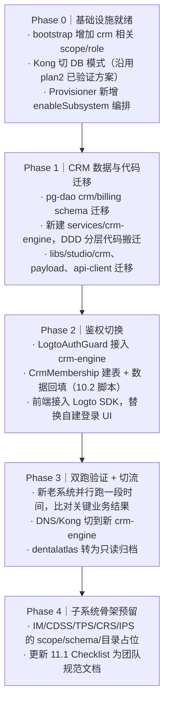

**每阶段验证标准**

| 阶段 | 验证标准 |
|---|---|
| Phase 0 | `pnpm bootstrap` 幂等跑通；Kong DB 模式起容器成功；`enableSubsystem` 单测覆盖开通/回滚路径 |
| Phase 1 | `nx run crm-engine:test` 全绿；`prisma migrate deploy` 在全新库上跑通；前端 CRM 页面可对接新 engine（先用假 token） |
| Phase 2 | 用真实 Logto 环境登录，`CompatSession` 与 `CrmMembership` 联动鉴权全链路（5.5 时序图）跑通；9 个角色权限矩阵回归测试通过 |
| Phase 3 | 关键业务报表（订单量、账单金额）新老系统一致；灰度用户无异常反馈；切流后 dentalatlas 只读 |
| Phase 4 | 团队按 Checklist 能在 ≤1 天内跑通一个新子系统的骨架搭建（哪怕业务逻辑是空的） |

---

## 13. 风险与开放问题

1. **数据迁移风险（关联假设 A4）**：如果 dentalatlas 已有生产数据，10.2 的迁移脚本需要升级为支持双写灰度、而不是一次性批量导入，工作量会显著增加。
2. **密码迁移风险（10.3）**：Logto 是否支持导入已有密码哈希需要单独调研，如果不支持，需要提前规划用户"重置密码"的通知与体验。
3. **`billing` schema 归属**：本方案默认 `billing` 继续归 CRM 域（9.2），如果未来 IPS（智能采购）或其他子系统也需要读写计费数据，需要重新评估是否要把 `billing` 提升为独立子系统。
4. **K8s 落地时机（假设 A7）**：本文档第 8 章的 K8s 拓扑是目标态，当前实现（`ComposeDeployer`）距离生产多租户还有差距，需要单独立项做 `K8sDeployer`。
5. **细粒度角色是否会跨子系统复用**：目前假设 `doctor/sales/qc/...` 只对 CRM 有意义；如果未来 IM/TPS 也需要"医生"这个身份参与协作（例如医生在 IM 里和技工沟通），需要决定这类"跨子系统但语义相同"的角色，是每个子系统各自建一份，还是抽出一个跨子系统共享的角色注册表。这个问题现在无法预判，建议留到真正接入第二个子系统时再决策，避免过度设计。

---

## 14. 参考资料

- `docs/iam/plan1.md` — 独立 Logto IAM 平台设计
- `docs/iam/plan2.md` — Kong 动态路由与域名自动化
- `docs/iam/plan3.md` — ray 硬切换 better-auth → Logto
- `iam/shared/src/{authorize,jwt,identifier}.ts` — 已实现并测试的鉴权内核
- `iam/provisioner/src/{provision-tenant,database-provisioner,routing/kong-admin,deploy}.ts` — 已实现并测试的开通编排
- `iam/bootstrap/src/config.ts` — 已有的 Logto 资源期望状态定义（`access:crm` 已预留）
- dentalatlas `libs/auth/src/permissions.ts` — 现有 9 角色细粒度权限矩阵（本方案原样保留其判定逻辑）
- dentalatlas `libs/pg-dao/src/models/{crm,billing,auth}.prisma` — 现有数据模型（本方案的迁移对象）
